# 操作系统实验报告

## 实验基本信息

| 项目 | 内容 |
|------|------|
| **实验名称** | Lab 2：物理内存和页表 |
| **小组成员** | 2413802-邢陶清、2410867-于润泽 |
| **报告更新日期** | 2026-10-23 |

### 小组分工

**练习分工：**

| 成员 | 负责的练习/模块 |
|------|----------------|
| 2413802-邢陶清 | 功能模块二的任务三（Buddy System）及 QEMU/MMU 分支任务 |
| 2410867-于润泽 | 功能模块一及物理内存探测 Challenge；功能模块二的任务一（First-Fit）和任务二（Best-Fit） |

**实验报告分工：**

| 成员 | 负责的报告内容 |
|------|----------------|
| 2413802-邢陶清 | 本人负责的任务及相关分析 |
| 2410867-于润泽 | 整体框架、实验目的、整体逻辑分析、总结与收获及本人负责的任务 |

---

## 一、实验目的

本实验围绕“内核如何找到、管理并使用物理内存”展开，在能够启动 ucore 的基础上，理解页表映射与物理页分配之间的关系，建立后续虚拟内存管理所需的基础。主要目标如下：

1. 理解 RISC-V Sv39 分页机制，掌握虚拟地址、物理地址、物理页号之间的区别，以及启动页表、`satp` 寄存器和 TLB 在地址转换中的作用。
2. 掌握物理内存初始化过程：从设备树读取内存范围，建立 `Page` 描述符数组，排除固件、内核镜像、描述符数组及对齐空隙，将剩余完整页面交给物理内存管理器。
3. 理解 `pmm_manager` 提供的统一接口，分析 First-Fit 的初始化、分配、回收和合并过程，并实现 Best-Fit，比较不同连续物理内存分配策略的查找开销与碎片问题。
4. 通过 Buddy System 任务理解按 2 的幂次组织空闲块、分裂大块和合并伙伴块的方法。
5. 结合内核自检、自动评分和 QEMU/GDB 调试，学习从状态变化和执行路径判断实现是否正确，区分算法问题与运行环境问题。
6. 学习按照 `[PROMPT]`、`[RELY]`、`[GUARANTEE]`、`[SPECIFICATION]` 组织需求，用明确的接口、前后置条件和边界情况约束 AI 生成代码，并通过源码检查与实际运行验证结果。

---

## 二、实验环境

本组使用的 AI 工具（不同成员的运行环境分别记录）：

| 成员 | AI 编程工具 | 底层模型 | 备注 |
|------|------------|---------|------|
| 2413802-邢陶清 | Codex | GPT-6 Astra | Buddy 实现与 QEMU/MMU 调试 |
| 2410867-于润泽 | Codex | GPT-5.6 |

### 邢陶清的实现与调试环境

- WSL Ubuntu 22.04，RISC-V 交叉编译工具链 `riscv64-unknown-elf-*`。
- 内核调试器为 RISC-V GDB 14.2；宿主侧使用普通 GDB 调试 QEMU 进程。
- 系统原有 QEMU 软件包版本为 `1:6.2+dfsg-2ubuntu6.31`。源码调试使用单独构建的上游 QEMU 6.2.0，二者不能混用调试符号。
- 构建时使用 `--target-list=riscv64-softmmu --enable-debug --disable-werror --disable-docs --python=/usr/bin/python3`。检查配置确认 `debug=true`、`optimization=0`。
- 调试版位于 `/home/heweiren/work/qemu-debug/qemu-6.2.0/build-debug/qemu-system-riscv64`，随后将 `/usr/bin/qemu-system-riscv64` 链接到该程序。源码及构建目录需要保留。
- Lab2 的 `qemu`、`debug`、`test` 目标均采用 `-bios default -kernel $(UCOREIMG)`；`debug` 另带 `-s -S`。

---

## 三、实验整体逻辑分析

### 3.1 本章节的逻辑主线

Lab 2 的核心是建立一条从硬件内存信息到内核内存分配接口的完整链路。上一实验解决了内核启动问题，本实验进一步解决三个问题：物理内存在哪里，哪些页面可以使用，以及收到分配和释放请求时如何维护这些页面。

这里需要区分两个层面。页表负责建立虚拟地址到物理地址的映射，使内核能够通过高地址访问实际内存；物理页分配器负责记录页面的占用状态，为内核挑选空闲的物理页。分配到页面并不等于创建了新的页表映射，二者通过地址转换和页描述符联系起来。

本实验框架在 `entry.S` 中准备启动页表，设置 `satp` 并执行 `sfence.vma`，随后进入 C 语言入口 `kern_init()`。`kern_init()` 先清零 BSS，再调用 `dtb_init()` 保存设备树中的内存信息，之后执行 `pmm_init()`。因此，补全物理内存管理代码时，必须沿用框架已经建立的虚实地址关系。

主要调用关系如下：

```text
entry.S：设置启动页表、satp 和内核栈
    ↓
kern_init()：清零 BSS → dtb_init() → pmm_init()
    ↓
pmm_init()
    ├─ init_pmm_manager()：选择分配算法，初始化其内部状态
    ├─ page_init()：确定可管理范围，建立 Page 数组并保留已用页面
    │    └─ init_memmap() → pmm_manager->init_memmap()
    └─ check_alloc_page() → pmm_manager->check()

后续分配和释放：
alloc_pages()/free_pages() → 当前 pmm_manager 的相应接口
```

`struct Page` 描述一个物理页，`pages` 指向描述符数组；空闲块链表则用块首页的 `page_link` 连接各个空闲块。`Page` 描述符地址、描述符所对应的物理页地址和内核访问该页时使用的虚拟地址，分别属于不同概念。把这几种地址区分清楚，是初始化和分配算法能够正确配合的前提。

### 3.2 功能的逐步实现

1. **理解启动页表和地址转换。** 内核链接地址位于高虚拟地址区，实际镜像加载在物理地址 `0x80200000` 附近。框架通过 Sv39 根页表中的叶子项建立 1 GiB 大页映射，使高地址内核可以运行。当前直接映射区域中，虚拟地址减去 `PHYSICAL_MEMORY_OFFSET` 可得到物理地址。这个关系只适用于框架约定的映射区域，不能作为任意虚拟地址的转换规则。

2. **探测内存并初始化页描述符。** 通过设备树得到物理内存的起点和大小，再结合 `PHYSICAL_MEMORY_END` 确定内核可管理的上界。`page_init()` 把描述符数组放在内核镜像之后，并先将所有描述符标为保留，再将数组末尾之后的完整页面注册为空闲页。只有先明确内存边界和保留区域，后续分配器才不会把内核自身使用的空间分出去。

3. **理解统一接口和 First-Fit。** `pmm_manager` 把初始化、注册空闲页、分配、释放、统计和自检封装为函数指针。First-Fit 提供了完整参考实现：按地址维护空闲块，找到第一个足够大的块，必要时分裂，释放后合并相邻块。阅读这部分代码，可以先掌握各函数共同维护的状态约定。

4. **实现并接入 Best-Fit。** 在相同接口和页状态约定下，将选择策略改为“从所有能够满足请求的空闲块中选出最小的一块”。同时实现完整的初始化、分裂、回收、合并和注册逻辑，并在 `init_pmm_manager()` 中切换管理器，使实际运行和自检使用新实现。

5. **实现 Buddy System。** 将空闲块按阶组织，以分裂和合并伙伴块处理页级请求，明确非 2 的幂请求、初始区域对齐和整块释放的约定。分别设计实现提示词与测试提示词，通过独立测试上下文检验与生产回调共用的核心算法。

6. **通过测试和调试验证各层行为。** 分配器自检关注页面是否重复分配、空闲计数是否正确、选择策略是否符合要求以及回收后能否恢复状态。自动评分检查指定初始化条件和管理器接入情况；Buddy 还需要独立的测试。QEMU/MMU 分支任务则从模拟器内部观察地址转换和 TLB 相关路径，把页表原理与一次实际访存联系起来。

---

## 四、实验内容与实现

### 练习：[任务一：实现物理内存探测与页描述符初始化功能]

**负责人：** [2410867-于润泽]

#### 模块功能描述

**需要实现的函数：**

```c
// kern/mm/pmm.c
static void page_init(void);
```

**功能说明：**

`page_init()` 将设备树解析得到的物理内存信息转化为分配器可以管理的页面。它由 `pmm_init()` 调用，不接收参数，也不返回结果；成功执行后应建立正确的地址偏移、物理页号范围和 `Page` 数组，并通过 `init_memmap()` 将真正可用的完整页面交给当前 `pmm_manager`。

实现时，先读取内存起点和大小，检查空值、地址相加溢出以及内存范围是否包含内核。随后输出探测范围，将内存末端限制在框架可管理上界内并向下按页对齐。描述符数组放在内核 `end` 之后的页边界上，先清零并将全部页面标为保留，再把描述符数组之后的完整页面注册为空闲页。

几个关键量的含义如下：

| 量 | 含义及关系 |
|------|------|
| `va_pa_offset` | 当前内核直接映射区域的虚实地址偏移，取 `PHYSICAL_MEMORY_OFFSET` |
| `maxpa` | 可管理物理内存的排他上界，为设备树末端与框架上界的较小值，再向下按页对齐 |
| `npage` | `PPN(maxpa)`，表示物理页号上界 |
| `nbase` | `DRAM_BASE / PGSIZE`，表示框架 DRAM 起点对应的物理页号 |
| `npage - nbase` | 描述符数量，每个描述符对应一个物理页 |
| `pages` | 描述符数组的虚拟地址，为内核 `end` 向上按页对齐后的地址 |
| `freemem` | 描述符数组末端转换为物理地址后，再向上按页对齐得到的空闲区起点 |

例如，默认 128 MiB 内存对应 `[0x80000000, 0x88000000)`，此时 `npage = 0x88000`，`nbase = 0x80000`，描述符数量为 32768。该数量包含保留页，因此不能直接作为空闲页数。

初始化后的布局可概括为：

```text
低物理地址
    OpenSBI 保留区
    内核镜像
    页对齐空隙
    Page 描述符数组
    页对齐空隙
    可分配的完整物理页
    不足一页的尾部（如有，不纳入管理）
高物理地址
```

本任务沿用实验固定 DRAM 起点和单段内存的框架约定。已有 DTB 解析结果由 getter 提供，`page_init()` 不需要重新解析设备树，也不负责实现通用的多内存区间管理。

#### 最终提示词

````markdown
[PROMPT]
任务：在 ucore Lab 2 的 kern/mm/pmm.c 中实现物理内存探测与
Page 描述符初始化函数 page_init()。

操作要求：先阅读 pmm.c、pmm.h、memlayout.h、mmu.h、riscv.h、
defs.h 和 dtb.h，在标有 lab2 function1 的位置修改实际文件。
保留 lab2 注释，将 YOUR CODE 替换为学号 2410867。
保持已有启动流程、设备树解析函数和分配器实现不变。

输出要求：按下列依赖和规格完成实现，简要说明修改位置与检查结果。
以工程中的真实定义为准，不引入其他平台的地址宏或不存在的接口。

[RELY]
1. 框架相关常量和宏：
   - PGSIZE = 4096，PGSHIFT = 12；
   - DRAM_BASE = 0x80000000；
   - KERNEL_BEGIN_PADDR = 0x80200000；
   - PHYSICAL_MEMORY_END = 0x88000000；
   - PHYSICAL_MEMORY_OFFSET = 0xFFFFFFFF40000000；
   - PPN、PADDR、ROUNDUP、ROUNDDOWN、SetPageReserved。
   PADDR 使用 va_pa_offset，因此必须先设置偏移再调用该宏。
   当前 pmm.h 中的 KADDR 被注释掉，不能依赖它。

2. 数据结构和全局量：
   struct Page {
       int ref;
       uint64_t flags;
       unsigned int property;
       list_entry_t page_link;
   };
   struct Page *pages;
   size_t npage;
   uint64_t va_pa_offset;
   const size_t nbase = DRAM_BASE / PGSIZE;
   extern char end[];

   end 和 pages 都是内核虚拟地址；npage 是物理页号上界。
   pages[i] 对应物理页号 nbase + i。
   描述符数量是 npage - nbase，不是 npage。

3. 已有函数：
   uint64_t get_memory_base(void);
   uint64_t get_memory_size(void);
   static void init_memmap(struct Page *base, size_t n);
   static inline struct Page *pa2page(uintptr_t pa);
   可使用 memset、panic 和 cprintf。
   这些函数已经由框架提供，不要重新实现。

[GUARANTEE]
必须实现：
```c
static void page_init(void);
```
由已有 pmm_init() 调用，正确设置 va_pa_offset、npage、pages，
输出探测到的内存范围，并在存在完整空闲页面时注册初始空闲区。

[SPECIFICATION]
## page_init
Pre-Condition:
- 系统处于启动初始化阶段，已有内核映射可用。
- dtb_init() 已执行，可通过 getter 获取解析结果；结果可能无效。
- 当前 pmm_manager 已选定，其 init() 已完成。
- 框架使用固定 DRAM_BASE 和单段物理内存模型，链接符号 end 有效。

Post-Condition:
- 正常返回时，va_pa_offset 等于框架规定的虚实地址偏移。
- 可管理范围不超过设备树给出的内存末端及 PHYSICAL_MEMORY_END，
  其上界按页面向下对齐；npage 表示该上界的物理页号。
- pages 位于内核镜像之后，按页对齐，覆盖 [nbase, npage) 的描述符。
- OpenSBI 保留区、内核、描述符数组及相关对齐空隙不进入空闲区。
- 只有描述符数组之后、可管理上界之前的完整页面交给分配器。

  Case 1：设备树信息无效。
  内存起点或大小为零、起点与大小相加溢出，或内存范围不包含
  内核起始地址时，调用 panic 终止初始化，不注册空闲页面。

  Case 2：可管理空间不足。
  可管理页号上界不高于 nbase、内核末端越过上界，或无法容纳
  对齐后的完整描述符数组时，调用 panic；必须先完成容量检查，
  再向描述符数组写入。容量检查应避免乘法溢出。

  Case 3：存在可用完整页面。
  输出设备树探测到的原始大小和起止物理地址；内部区间采用
  排他上界，打印最后一个字节地址时使用末端减一。
  清零全部描述符并先标为保留，计算描述符数组末端对应的
  物理地址并向上按页对齐。将剩余完整页通过 pa2page 转换
  成描述符起点，调用一次 init_memmap 注册。

  Case 4：描述符数组可以放下，但没有剩余完整页面。
  完成全局量和描述符初始化，保留已用页面，不调用 init_memmap。

Requirements:
- 区分虚拟地址、物理地址、物理页号和 Page 描述符地址。
- 不硬编码探测结果为 128 MiB；使用 getter 提供的信息和框架上界。
- 不将内核或描述符数组所在的页面分配出去。
- 不修改教师测试和其他分配算法。
````

---

### Challenge：[硬件的可用物理内存范围的获取方法]

**负责人：** [2410867-于润泽]

本项目通过设备树（DTB）在启动时获取物理内存范围，具体流程如下：

1. **提供内存信息**：QEMU 根据虚拟机配置生成设备树，在 `memory` 节点中记录物理内存的起始地址和大小。
2. **传给内核**：OpenSBI 通过寄存器 `a1` 把设备树的地址传给内核，`entry.S` 将其保存到 `boot_dtb`。
3. **解析内存范围**：`dtb_init()` 读取设备树中 `memory` 节点的 `reg` 属性，得到内存起点和大小，内核因此能够确定实际 RAM 范围。
4. **确定可分配页面**：`page_init()` 根据上述范围，排除 OpenSBI、内核和页描述符数组占用的空间，将剩余完整页面交给物理内存管理器。

---

如果设备树也不可用，可以由固件或引导程序传入内存映射，或在已知平台上读取内存控制器配置。探测到 RAM 后还必须排除固件和设备保留区域。对未知地址盲目读写可能访问 MMIO 或造成无法恢复的异常，因此不能将“写到失败”为止当作通用且安全的探测办法。此处是备选方案分析，本项目仍使用 DTB。

### 练习：[任务一：理解 First-Fit 连续物理内存分配算法]

**负责人：** [2410867-于润泽]

First-Fit 使用按物理地址递增排列的空闲块链表，分配时选择第一个能够满足请求的块。

1. **初始化：** `default_init()` 建立空链表，将空闲页数清零。随后，`default_init_memmap()` 将传入的可用页面标为空闲，在块首页记录连续页数，并按地址顺序加入链表。

2. **分配：** `default_alloc_pages(n)` 从链表头开始寻找第一个不少于 `n` 页的空闲块。如果大小刚好合适，就分配整块；如果更大，就分配前 `n` 页，将剩余部分留在链表中。找不到足够大的连续块时返回 `NULL`。

3. **回收与合并：** `default_free_pages(base, n)` 将释放的页面重新组成空闲块，按地址插入链表，再检查前后两个空闲块。如果物理地址连续，就将它们合并，形成更大的空闲块。同时更新页面状态和空闲总页数。

原有算法还有改进空间。首先，每次分配都从头查找，空闲块较多时效率较低，可以增加索引，跳过不可能满足请求的区间，同时保持“选择第一个合适块”的规则。其次，当前 `default_init_memmap()` 只插入空闲块，可以补充相邻块合并，使多次注册的连续区域从一开始就形成大块。

一种保持 First-Fit 语义的具体索引是按地址排序的平衡树，并在节点记录子树最大空闲块大小。查找时先判断左子树是否存在够用块，再检查当前节点，最后搜索右子树，从而在平衡条件下用 `O(log k)` 找到地址最小的合适块。该方案仅作分析，当前代码仍为链表实现；相同分配选择下，查找加速本身不会改善碎片。

这些改进可以减少查找开销和不必要的小块，但无法完全消除外部碎片：空闲总页数足够时，仍可能因为缺少足够大的连续块而分配失败。

---

### 练习：[任务二：实现 Best-Fit 连续物理内存分配算法]

**负责人：** [2410867-于润泽]

#### 模块功能描述

**需要实现或修改的函数：**

```c
// kern/mm/best_fit_pmm.c：新增实现
static void best_fit_init(void);
static void best_fit_init_memmap(struct Page *base, size_t n);
static struct Page *best_fit_alloc_pages(size_t n);
static void best_fit_free_pages(struct Page *base, size_t n);
static size_t best_fit_nr_free_pages(void);
static void best_fit_insert_block(struct Page *base);

// kern/mm/pmm.c：修改管理器选择
static void init_pmm_manager(void);
```

同时定义 `const struct pmm_manager best_fit_pmm_manager`，将各接口与实现函数关联。教师已有的 `basic_check()`、`best_fit_check()` 保持不变；通过前向声明，使注册结构中的 `.check` 能指向后面定义的 `best_fit_check()`。

**功能说明：**

Best-Fit 与 First-Fit 使用相同的页描述符和分配接口，但选择策略不同：对于申请的 `n` 页，遍历所有能够容纳请求的空闲块，选择页数最少的块；遇到恰好为 `n` 页的块时可以提前结束。多个候选块大小相同，则保留最先遇到、地址较低的块。

本实现仍按地址组织空闲链表，便于释放时寻找物理相邻块。`best_fit_insert_block()` 负责有序插入与前后合并，初始空闲区注册和页面释放都复用这个辅助函数。分配器对成功的请求实际分配 `n` 页，较大的空闲块则保留尾部剩余页面。失败请求返回 `NULL`，不改变链表和空闲计数。

例如，先出现一个 2 页空闲块，后面出现一个 1 页空闲块，申请 1 页时应选择后者。这样既能说明 Best-Fit 的策略，也对应教师测试中能够区分 First-Fit 与 Best-Fit 的场景。

#### 最终提示词

````markdown
[PROMPT]
任务：参考 kern/mm/default_pmm.c，在 kern/mm/best_fit_pmm.c
中 lab2 function2-2 标记处实现完整 Best-Fit 连续物理页分配模块，
并在 kern/mm/pmm.c 的 init_pmm_manager() 中接入。

操作要求：直接修改工程实际文件。保留 lab2 标记，将 YOUR CODE
替换为 2410867。先阅读 pmm.h、memlayout.h、list.h 和教师测试。
保持 basic_check()、best_fit_check() 的函数体不变，保留已有
First-Fit 实现和 page_init()，不要通过修改断言使测试通过。

输出要求：交付完整管理器及接入修改，简要说明实现与验证结果。
使用项目指定的 QEMU 4.1.1；先核对 make print-QEMU 指向的路径，
必要时仅调整项目 Makefile 的 QEMU 配置。保留其他课程使用的
QEMU 7.0.0，不因启动停滞而直接改写教师的启动汇编或评分脚本。
在支持交叉编译的 Ubuntu 环境中验证；不能执行时明确说明限制。

[RELY]
1. Page 和 free_area_t 由 memlayout.h 提供：
   - Page.ref：引用计数；
   - Page.flags：状态位；
   - Page.property：空闲块首页记录的连续页数；
   - Page.page_link：空闲块链表节点；
   - free_area_t.free_list：双向循环链表头；
   - free_area_t.nr_free：空闲总页数。

2. 可用接口和宏：
   list_init、list_empty、list_next、list_prev、
   list_add、list_add_before、list_del、le2page；
   PageReserved、PageProperty、SetPageProperty、ClearPageProperty；
   set_page_ref、assert，以及框架已有的页分配包装函数。

3. pmm.h 中 struct pmm_manager 的注册成员为：
   name、init、init_memmap、alloc_pages、free_pages、
   nr_free_pages、check。
   best_fit_pmm.h 已声明 best_fit_pmm_manager，不重复定义类型。

4. 教师测试直接使用 free_list 和 nr_free。采用：
   static free_area_t free_area;
   #define free_list (free_area.free_list)
   #define nr_free (free_area.nr_free)
   保持这些状态与各管理函数一致。测试会暂时清空链表，而未立即
   清零 nr_free，因此不能仅根据计数推断链表一定存在可分配块。

[GUARANTEE]
在 best_fit_pmm.c 中实现：
```c
static void best_fit_init(void);
static void best_fit_init_memmap(struct Page *base, size_t n);
static struct Page *best_fit_alloc_pages(size_t n);
static void best_fit_free_pages(struct Page *base, size_t n);
static size_t best_fit_nr_free_pages(void);
static void best_fit_insert_block(struct Page *base);
```
定义 const struct pmm_manager best_fit_pmm_manager，并完整注册接口。
声明已有的 static void best_fit_check(void)，将其注册为 check。
在 pmm.c 中修改 static void init_pmm_manager(void)，选择
best_fit_pmm_manager，继续输出名称并调用该管理器的 init()。
辅助函数保持 static，不改变公开接口。

[SPECIFICATION]
## 全局状态约定
- 正常运行时，空闲块按物理地址递增排列，互不重叠。
- 每个空闲块只将首页加入链表，首页设置 PageProperty，
  property 为块内页数；非首页不设置该标志。
- nr_free 等于空闲块页数之和，不包含保留页和已分配页。
- 分裂、合并不凭空增加或丢失页面。

## best_fit_init
Pre-Condition: 在启动阶段调用，尚未注册空闲内存区间。
Post-Condition: free_list 初始化为空循环链表，nr_free 为 0。

## best_fit_insert_block
Pre-Condition:
- base 表示一个新空闲块，首页标志和 property 已设置。
- 该节点尚未加入链表，且区间与现有空闲块不重叠。
- 调用者已更新 nr_free。
Post-Condition:
- 块按地址插入链表；如与前驱或后继物理连续，则完成合并。
- 合并后只保留最终块首页的有效标志、长度和链表节点。
- 被并入的旧首页清除 PageProperty 并将 property 清零。
- 本函数不修改 nr_free。
  Case 1: 链表为空或两侧均不连续时，只完成插入。
  Case 2: 与前驱连续时合并到前驱，以合并后的首页检查后继。
  Case 3: 与后继连续时继续合并；允许一次操作完成两侧合并。

## best_fit_init_memmap
Pre-Condition:
- n > 0，base 指向合法的连续 Page 描述符区间。
- 区间内各页均处于保留状态，且属于允许注册的可用物理内存。
Post-Condition:
- 这些页的引用计数、旧状态和 property 已清理。
- 新块首页记录 n 页并设置空闲块首页标志，nr_free 增加 n。
- 使用插入辅助函数完成有序入链和相邻合并。
Requirements: 用断言检查 n > 0 和初始保留状态。

## best_fit_alloc_pages
Pre-Condition: n > 0，由调用者提出连续页请求。
Post-Condition:
- 成功时返回恰好 n 个连续可用物理页的起始描述符，
  nr_free 减少 n，返回块首页不再具有 PageProperty，property 清零。
- 失败时返回 NULL，不改变链表、页面状态和空闲总量。
  Case 1：资源不足。
  n 大于 nr_free，或链表为空，或没有一个连续块足够大时返回 NULL。
  即使 nr_free 非零，空链表也必须返回 NULL。
  Case 2：存在候选块。
  选择所有 property >= n 的块中最小者；同样大小时选地址最低者。
  遇到精确匹配可提前结束查找，不能遇到第一个较大块就返回。
  Case 3：精确匹配。
  将整个候选块移出空闲链表，不生成剩余块。
  Case 4：需要分裂。
  分配候选块的前 n 页，将尾部剩余页组成新的空闲块，
  保留在原链表位置，确保地址顺序和状态正确。
Requirements: 对 n == 0 使用断言，不将其作为正常分配请求。

## best_fit_free_pages
Pre-Condition:
- n > 0，base 开始的 n 页均在合法管理范围内，且当前属于已分配页。
- 调用者保证区间没有越界、重复释放或与现有空闲块重叠。
- 允许释放合法分配区间的一部分，或一段连续的已分配页面；
  不要求 base、n 必须恰好等于某次完整分配的返回值和长度。
Post-Condition:
- 释放区间的引用计数、状态及 property 已清理。
- 建立 n 页空闲块，nr_free 增加 n，再按地址插入并合并。
- 既可只向前或向后合并，也可同时合并两侧，保留页不会进入链表。
Requirements:
- 使用断言检查 n > 0，且待释放页没有保留标志或空闲块首页标志。
- 不把这些断言宣称为完整的非法释放检测机制。

## best_fit_nr_free_pages
Pre-Condition: 管理器内部状态已初始化。
Post-Condition: 返回 nr_free，不修改任何状态。

## init_pmm_manager 与注册结构
Pre-Condition: 内核处于物理内存管理初始化阶段。
Post-Condition:
- pmm_manager 指向 best_fit_pmm_manager。
- 注册结构中的管理接口指向上述实现，check 指向教师的 best_fit_check。
- 输出选中的管理器名称并调用 init，之后 page_init 可注册空闲页面。

## 验证要求
- 不修改教师测试函数。
- 在 Ubuntu 中先 make clean，再 make test，检查管理器名称、
  6/6 评分输出和 check_alloc_page() succeeded!。
- make test 完成输出后，先按 Ctrl+A，再按 X 退出 QEMU。
- 运行 make grade，检查 page init 和 best fit 两项均为 OK。
- 若停留在固件输出，先核对实际 QEMU 路径和版本、内核是否进入
  初始化阶段，再判断是否属于分配器问题。
````

#### 实现迭代过程

以下保留于润泽在其个人环境中的两轮实现与验证记录。其 QEMU 4.1.1 路径和评分截图不代表邢陶清当前的调试环境；后者使用 QEMU 6.2.0，见本报告环境补充与 QEMU/MMU 分支任务。

##### 第一轮：完成实现，但运行停在 OpenSBI 输出

**遇到的问题：**

执行 `make clean`、`make test` 后，编译和链接均完成，但终端只显示 OpenSBI 启动信息，未继续出现 `DTB Init`、内存管理器名称和分配器评分。最初容易把这一现象理解为新写的 Best-Fit 代码没有运行成功。

检查后发现，该成员当时系统默认使用 QEMU 7.0.0，指导书示例使用 QEMU 4.1.1。进一步查看启动异常日志，可以看到进入高地址内核之前出现了取指页故障；此时尚未执行到 Best-Fit 的检查。因此应先解决实验启动方式与运行环境的兼容问题。

**问题解决策略：**

在提示词的运行要求中补充：先确认实际执行的 QEMU 路径和版本；若停留在固件阶段，先定位启动流程，不直接归因于分配算法，也不直接改写教师提供的启动汇编和评分脚本。为 OS 实验单独安装 QEMU 4.1.1，通过项目 Makefile 指定其路径，同时保留其他课程使用的 QEMU 7.0.0。

##### 第二轮：指定实验版本并重新验证

将项目 Makefile 中的 QEMU 路径设为：

```makefile
ifndef QEMU
QEMU := /mnt/c/Users/zeze2/Desktop/experiment/OS/qemu-4.1.1-install/bin/qemu-system-riscv64
endif
```

随后重新执行 `make clean`、`make test`，内核正常输出：

```text
memory management: best_fit_pmm_manager
grading: 1 / 6 points
grading: 2 / 6 points
grading: 3 / 6 points
grading: 4 / 6 points
grading: 5 / 6 points
grading: 6 / 6 points
check_alloc_page() succeeded!
```

继续执行 `make grade`，得到：

```text
-check page init:                          OK
-check best fit:                           OK
Total Score: 20/20
```

**最终结果：**

- 编译和链接通过。
- 教师提供的分配器自检正常完成，输出 6/6。
- 自动评分中的初始化和 Best-Fit 接入检查通过，得分 20/20。

这里需要区分测试作用：`best_fit_check()` 中的断言验证分配、回收及 Best-Fit 选择行为；`tools/test_lab2.c` 中的 `test_best_fit()` 主要检查当前管理器是否为 `best_fit_pmm_manager`，单独这一项并不能证明全部算法细节正确。

**关键改进点总结：**

1. 将工具版本和实际执行路径纳入提示词，保证验证环境符合实验要求。
2. 按启动输出定位执行阶段，区分尚未进入内核的异常与分配器内部错误。
3. 将编译、自检和评分结合起来，避免只凭编译成功或某一条 PASS 判断任务完成。

#### Best-Fit 算法是否有进一步的改进空间

有。设空闲块数量为 `k`，当前 Best-Fit 实现在分配时最坏需要遍历整个链表，时间复杂度为 `O(k)`；释放时查找插入位置也需要 `O(k)`。可以考虑以下改进：

1. **优化空闲块的查找结构。** 使用平衡树按块大小组织空闲块，将“查找满足请求的最小块”的复杂度降低到 `O(log k)`。同时保留按地址查找相邻块的结构，便于释放时合并。代价是增加存储开销，并在分裂、合并时同步更新两种结构。

2. **按块大小分组管理。** 将大小相近的空闲块放入同一组，分配时优先查找可能满足请求的组，减少无关块的比较。若要保持严格的 Best-Fit 策略，仍需在候选组中选择最小的合适块，不能直接取第一个。分组可以改善查找效率，但不一定降低最坏情况下的复杂度。

3. **配合小对象分配器。** 对于远小于一页的请求，可以在 Best-Fit 之上使用对象分配器，将一页划分为多个对象空间，减少小对象独占整页造成的浪费。这属于分配层次上的改进。

4. **完善释放检查和测试。** 增加对重复释放、越界释放的检查，避免破坏空闲链表。同时通过连续的分配与回收测试，观察空闲总页数和最大连续空闲块的变化，评估算法的碎片情况。

Best-Fit 能使单次分配后的剩余空间尽量小，但仍可能产生较多小碎片。上述优化可以提高查找效率和可靠性，不能保证完全消除外部碎片。

---

### 练习：[任务三：buddy system(伙伴系统)分配算法]

**负责人：** [2413802-邢陶清]

#### 实现思路与接口约定

代码位于 [buddy_pmm.c](../code/kern/mm/buddy_pmm.c) 和 [buddy_pmm.h](../code/kern/mm/buddy_pmm.h)。通过 `buddy_pmm_manager` 接入既有接口，当前 `pmm.c` 已选择 Buddy。未扩展共享 `struct Page`，内部使用 `buddy_area` 保存各阶空闲链表、描述符范围、首物理页号及空闲页数。

`free_list[order]` 存放大小为 `2^order` 页的块，支持阶数 0～31；最大阶是实现上限，并不表示机器实际有这么多内存。空闲块首页的 `property` 存放块页数并设置 `PG_property`；已分配块首页设置私有标志 `BUDDY_ALLOCATED = 1UL << 2`，其 `property` 存放原始请求页数。

- **初始化：** 验证输入页原先为 Reserved，清理状态。根据当前绝对物理页号和剩余长度，选出满足对齐条件的最大 2 的幂块，逐块登记。判断 `(ppn & (size - 1)) == 0` 保证物理对齐，不能只按剩余页数划分。比如页号 `[3,16)` 可划分成 1、4、8 页，不丢弃尾部页面。管理器 `init` 早于 `page_init`，因此真实描述符范围在首次 `init_memmap` 时绑定。
- **分配：** 将请求向上取整为 2 的幂，从目标阶向上寻找非空链表，取出大块后逐级对半拆分，另一半重新入链。申请 3 页实际占用 4 页，空闲计数扣除 4。
- **释放：** 必须传回原始首页和原始请求页数，只支持整块释放。由记录的请求恢复阶数，清理实际占用的完整块，再逐级寻找并合并空闲伙伴；不沿用 First-Fit 的部分释放约定。
- **伙伴定位：** 使用 `buddy_ppn = ppn ^ (1UL << order)`。换算成数组下标前检查范围，且只有具有空闲首页标志、大小相同的块才参与合并。相邻且同样大的块未必是伙伴，例如 `[4,8)` 与 `[8,12)` 不能合并。

向上取整产生内部碎片，例如申请 5 页占用 8 页；伙伴系统也可能因缺少可合并的大块出现连续分配失败。实现没有采用复杂的数据结构，优先保证状态维护与边界处理清楚。

#### 两份提示词

开发时先生成独立模块与测试，再接入内核。原始分阶段提示词保存在 [实现提示词](../prompts/buddy_implementation.md) 和 [测试提示词](../prompts/buddy_tests.md)。下面提交的第一份为整理后的最终规格，补入了后续已经完成的内核接入要求；第二份保留独立测试约定，不修改管理器选择。

##### Prompt 1：实现并接入 Buddy System

````text
你是一名熟悉 RISC-V ucore 的内核开发者。请阅读本仓库 lab2 的
kern/mm/pmm.h、pmm.c、memlayout.h、default_pmm.c、best_fit_pmm.c、libs/list.h
及 Makefile，基于现有物理内存管理接口实现 Buddy System。

新增 kern/mm/buddy_pmm.c 和 buddy_pmm.h，导出 buddy_pmm_manager。
在 pmm.c 包含 buddy_pmm.h，并在 init_pmm_manager 中选择该管理器。
保留 First-Fit、Best-Fit 和 page_init，不修改共享页结构或启动汇编。
Makefile 已自动收集 kern/mm 下的源文件，不添加重复构建规则。
测试函数由第二份提示词补充，本阶段可以保留一个空的 static buddy_check
回调以保证模块可编译，不能把空回调描述为测试通过。

实现要求：

1. 沿用项目代码风格：返回类型单独一行、四空格缩进、花括号风格与
   default_pmm.c 一致，使用现有 list.h、assert 和 struct Page。
   内部函数声明为 static，不引入动态内存分配、外部依赖或复杂度无关的抽象。
2. 用按阶划分的空闲双向链表管理 2^order 页块，最大阶设置为 31。
   分配 n 页时向上取整到 2 的幂；找到最小可用阶，逐级对半拆分。
   精确满足阶数的块直接分配；不足时返回 NULL，不改变任何状态。
   n=0 是调用约定错误，触发 assert；极大 n 必须安全失败，不能移位溢出。
3. 使用绝对物理页号确定对齐和伙伴：buddy_ppn = ppn XOR (1UL << order)。
   换算回描述符索引前检查下界、上界以及完整块是否落在描述符范围内。
   只合并同阶且完整空闲的伙伴；不能跨越保留页或空洞。
   连续且可用的多个初始化区间允许在满足伙伴关系时合并。
4. 保留 struct Page 布局。空闲首页的 property 保存块页数，并设置
   PG_property；分配首页可使用当前未占用的 flags 位 2 作为模块私有标记，
   property 保存原始请求页数，并由请求推导实际阶数。明确注释该字段约定。
   非首页不持有块首页标记。删除空闲块时清除标记及旧 property。
5. free_pages 必须接收原始分配首页和原始请求页数，只支持整块释放。
   校验分配首页标记、请求大小和范围，拒绝内部页释放、重复释放和大小不匹配。
   非法释放使用 assert，正常释放清理整个实际块并递归或循环合并伙伴。
   nr_free_pages 统计真实可分配页数，例如申请 3 页应扣除 4 页。
6. init_memmap 接受任意合法起点和正页数，将区域拆成对齐的 2 的幂块，
   不遗漏页、不管理范围外的页。支持多次传入互不重叠的区域，验证输入页原先
   为 reserved；保留空洞不变。注意 pmm_manager.init 在 page_init 建立
   pages/npage 之前调用，因此不要在 init 中假设全局描述符数组已经初始化。
7. 为便于隔离测试，核心函数接受一个模块内部的 buddy_area 上下文，包含
   空闲链表、描述符数组、描述符数量、首物理页号和空闲页数。生产回调使用
   一个静态上下文；测试可以使用独立上下文，而不切换当前内核管理器。
8. 实现 pmm_manager 的 init、init_memmap、alloc_pages、free_pages、
   nr_free_pages 回调，头文件提供带 include guard 的管理器声明。
   说明释放约定的必要代码注释应保留。不要复制改写已有算法的测试函数。

完成后按项目选项编译，并检查启动输出的管理器名称。测试函数由下一份
提示词生成，在完成实际测试前不能声称算法已验证。明确说明实际执行的检查。
````

##### Prompt 2：生成测试函数

````text
请阅读本仓库 lab2/kern/mm/buddy_pmm.c、buddy_pmm.h 及现有 PMM 接口，
为第一份提示词生成的 Buddy System 实现编写实际可运行的 buddy_check()
及必要的 static 辅助函数，并连接 buddy_pmm_manager.check。

不要修改 pmm.c 的管理器选择、启动流程、共享结构和已有 First Fit/Best Fit
测试。不要输出实验报告或验证记录。维持项目 C 风格，不引入外部测试框架。

测试约定：

- 使用独立静态 buddy_area 和 64 个测试 Page 描述符。每个场景先初始化其
  reserved 状态，再向被测算法传入指定可用区间。无需访问对应的物理内存。
- 调用与生产管理器共用的分配、释放、初始化核心函数，禁止另写一份分配器
  作为测试对象。不得修改全局 pages、npage、pmm_manager 或真实分配器状态。
- 独立计算预期的向上取整大小，不仅仅复用被测函数计算期望值。
- 所有正常用例均能在同一次 check 调用中结束。零页请求和错误释放属于
  assert 合同，不要直接在正常启动测试中触发它们并导致后续测试无法运行。
  未实际执行的断言路径不能宣称已通过测试。

必须覆盖：

1. 空分配器请求失败；申请 1、2、4、8、16、32、64 页成功并能释放。
2. 申请 3、5、9、17、33 页分别占用 4、8、16、32、64 页；检查页数统计。
3. 从单个 64 页块连续拆分，分配块地址合法、按实际大小对齐、彼此不重叠。
4. 分配全部 64 个单页后继续请求失败，失败不改变计数和链表结构。
5. 只释放偶数页，虽有 32 页空闲但申请 2 页必须失败；随后释放其余页，
   检验逐级合并并再次成功分配完整的 64 页块。
6. 仅开放页号区间 [4,12)，其中 [4,8) 和 [8,12) 相邻但不是伙伴；
   申请 8 页应失败，不能误合并。
7. 模拟描述符数组的首物理页号为 3，开放不整齐的多个区间，例如索引
   [1,14)、[16,33)，保留中间空洞和两侧边界。验证总计 30 页均可分配、
   不重复且不越界；按打乱顺序释放后全部恢复，保留页状态不变。
8. 分两次、逆地址顺序初始化相邻的 32 页区域，最终应能申请完整 64 页。
9. 对混合请求 3、5、1、9、2 页反复分配、按不同顺序释放；检查每个实际
   占用区间互不重叠，每轮恢复初始页数和最大块。
10. 申请 65 页和 SIZE_MAX 等过大请求安全失败，无状态改变或整数溢出。

增加结构不变量检查函数：遍历各阶链表，检查双向链接、遍历次数上限、
节点范围、物理对齐、首页标志、块大小和所属阶一致；用独立位图标记页，
检查空闲块之间无重叠、不包含 reserved 页或已分配首页，总和等于 nr_free。
检查没有遗留的同阶可合并伙伴，并检查游离的 PG_property 标记。
在关键操作之后调用该检查，不要只检查程序没有崩溃。

测试代码可放在 buddy_pmm.c 的回调定义之前，使用静态测试数组以减少内核栈
占用。交付测试代码；可以进行独立编译和宿主侧核心逻辑检查，但不能把这些
检查声称为内核集成验证。当前不接入内核，不新增报告文字。
````

#### 测试覆盖与有效性

`buddy_check()` 使用独立的 64 个静态 `Page` 描述符和测试上下文，调用与真实管理器共用的核心函数，不改变全局真实页数组或空闲链表。预期取整大小单独计算，避免只用被测辅助函数产生期望值。

| 测试 | 核心行为和检验作用 |
|---|---|
| 请求 1、2、4、8、16、32、64 页及 3、5、9、17、33 页 | 验证精确阶数与向上取整，逐次检查实际空闲页数 |
| 连续分配全部 64 个单页 | 检查多级拆分、返回页不重复，以及耗尽后失败 |
| 仅释放偶数页，再申请 2 页 | 总空闲量为 32 页但没有伙伴对可合并，检验不能只看总量判断成功 |
| 释放其余页后申请 64 页 | 检验递归合并完整恢复，发现丢页或残留小块 |
| 只开放 `[4,12)`，申请 8 页失败 | 专门排除“相邻且同阶就合并”的错误 |
| 首物理页号为 3，开放索引 `[1,14)`、`[16,33)` | 检查非整齐起点、奇数长度、空洞和范围边界；30 页全部可用且保留页不变 |
| 逆序注册两个相邻的 32 页区域 | 检查多次初始化可正确合并成 64 页 |
| 3、5、1、9、2 页混合请求，打乱释放顺序，重复 16 轮 | 检查不同阶共存时的对齐、不重叠、计数及重复使用 |
| 空分配器、65 页和 `(size_t)-1` 请求 | 检查空闲不足与极大请求安全失败 |

结构检查还验证双向链接、节点范围、阶数对应的块大小、对齐、空闲页互不重叠、页数总和及没有遗留的可合并伙伴。这些检查能发现“返回了合法指针，但链表或统计已损坏”的问题。

**实际验证与限制：** 新文件通过项目交叉编译；宿主侧用 AddressSanitizer 和 UndefinedBehaviorSanitizer 执行了两次完整自检；随后在 QEMU 6.2.0 中启动，输出 `memory management: buddy_pmm_manager` 和 `check_alloc_page() succeeded!`。内核启动覆盖真实区域初始化，但 `.check` 内部的分配测试使用独立描述符，不等同于真实物理页读写压力测试。零页请求、错误释放等断言终止路径未在这轮正常自检中执行；不能把断言存在当作负例测试通过。


---

### 分支任务：GDB 调试 QEMU 的页表查询过程

**负责人：** 2413802-邢陶清

#### 调试目标与完成范围

本任务从 QEMU 的实现观察一条 RISC-V 访存指令如何完成地址转换。本次已实际观察栈写入的调用路径、Sv39 根页表查询、大页叶子识别、物理地址生成，以及传入 TLB 填充函数的参数。TLB 查询分支与软件/硬件差异另作源码分析；尚未完成命中路径单步演示和分页关闭前后的对照调试，不将这两项写为已实测。

#### 环境准备与启动故障定位

最初执行 `make qemu` 只出现 OpenSBI 输出，没有进入 `kern_init()` 的启动打印。日志中 `Domain0 Next Address` 为 `0x0`，提示下一阶段入口未正确传递。参考 Lab1 的 Makefile，把 Lab2 中的：

```makefile
-device loader,file=$(UCOREIMG),addr=0x80200000
```

替换为：

```makefile
-kernel $(UCOREIMG)
```

在 `qemu`、`debug`、`test` 三个目标中保持一致，`debug` 保留 `-s -S`。再次启动后下一阶段地址变为 `0x80200000`，内核能输出 `(THU.CST) os is loading ...` 并完成分配器检查。这个现象发生在 PMM 初始化之前，不能归因于 Buddy 或 Best-Fit。

系统安装的 QEMU 6.2 缺少调试符号，GDB 只能列出 `riscv_cpu_tlb_fill` 的非调试符号，无法显示局部变量与 C 源码。尝试通过 Ubuntu debuginfod 补齐符号时遇到连接超时及空缓存文件，最终从 QEMU 6.2.0 源码开启 `--enable-debug` 独立构建。该选项属于编译配置，不能作为已安装 QEMU 的运行参数；解决问题的关键是调试信息，而不是降级为指导书示例中的 4.1.1。

#### 双 GDB 的操作方法

三个终端的职责如下：

| 终端 | 程序与职责 |
|---|---|
| 1 | `make debug` 启动 QEMU；`-S` 暂停模拟 CPU，`-s` 提供 1234 调试端口 |
| 2 | 普通 GDB 附加 QEMU 进程，观察宿主侧 C 源码 |
| 3 | `make gdb` 启动 RISC-V GDB，连接模拟 CPU，观察 ucore 指令与寄存器 |

普通 GDB 使用 `attach <PID>` 附加，设置 `handle SIGPIPE nostop noprint pass` 后执行 `continue`。随后内核 GDB 在 `kern_init` 设置断点并继续运行。这里两个 `continue` 的对象不同：前者恢复整个模拟器进程，后者控制模拟 CPU。普通 GDB 暂停 QEMU 时，内核 GDB 会等待响应，这是双层调试的正常现象。

#### 目标指令与调用路径

##### 步骤 1：确认内核入口、分页状态和指令

在终端 3 中执行：

```gdb
break kern_init
continue
p/x $pc
p/x $satp
x/12i $pc
info registers sp a0 a1 a2
```

截图显示 PC 为 `0xffffffffc02000d8`，`satp=0x8000000000080205`，当前栈顶为 `0xffffffffc0205000`。这既确认已经进入高地址内核，又给出了计算访存地址所需的寄存器值。反汇编比 C 源码行号更适合本次观察，因为一个 C 语句会对应多条机器指令。

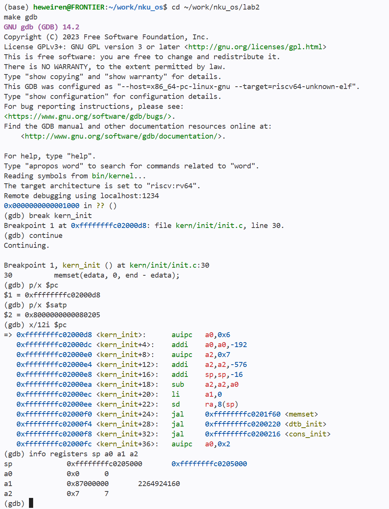

**图示说明：图 1：kern_init 入口、satp、反汇编和初始栈指针。**

内核 GDB 停在 `kern_init` 后，反汇编找到：

```asm
0xffffffffc02000e8: addi sp,sp,-16
0xffffffffc02000ee: sd   ra,8(sp)
```

##### 步骤 2：停在目标存储指令之前

终端 3 执行：

```gdb
tbreak *0xffffffffc02000ee
continue
x/i $pc
p/x $sp + 8
```

此时箭头指向 `sd ra,8(sp)`，表示该指令尚未执行；之前的 `addi sp,sp,-16` 已执行，所以有效地址为原栈顶减 16 再加 8，即 `0xffffffffc0204ff8`。临时断点命中后自动删除。

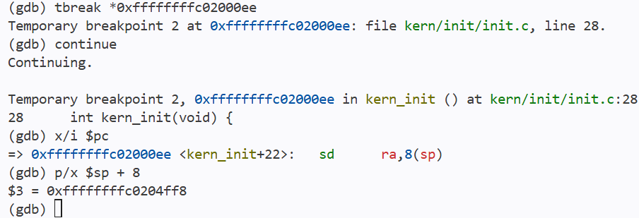

**图示说明：图 2：停在 sd 指令前，确认目标虚拟地址。**

在写入指令处设置临时断点，停下后得到 `sp + 8 = 0xffffffffc0204ff8`。选择这条写指令观察 8 字节存储，而不是通过 GDB 的内存读取命令代替 CPU 访存。

##### 步骤 3：捕获同一次存储的 QEMU 慢路径

先在终端 2 按 Ctrl+C，设置条件断点后恢复 QEMU，再在终端 3 执行 `si`。条件断点限定目标地址，避免被启动期间大量其他翻译打断。


在普通 GDB 设置条件断点：

```gdb
break riscv_cpu_tlb_fill if address == 0xffffffffc0204ff8
continue
```

然后在内核 GDB 执行一次 `si`。普通 GDB 命中断点，实测参数为 `size=8`、`access_type=MMU_DATA_STORE`、`mmu_idx=1`。调用栈显示以下路径：

```text
cpu_exec / cpu_loop_exec_tb / cpu_tb_exec
    → code_gen_buffer（TCG 生成的宿主机器码）
    → helper_le_stq_mmu
    → store_helper
    → tlb_fill
    → riscv_cpu_tlb_fill
    → get_physical_address
```

命中后在终端 2 执行：

```gdb
p/x address
p access_type
bt 8
```

`MMU_DATA_STORE` 与内核的 `sd` 对应，`size=8` 与双字存储长度一致。调用栈中的 `code_gen_buffer` 不是 ucore 源文件，而是 QEMU 动态生成的宿主机器码区域。本次截图同时连接了客体指令与模拟器的 C 函数路径。

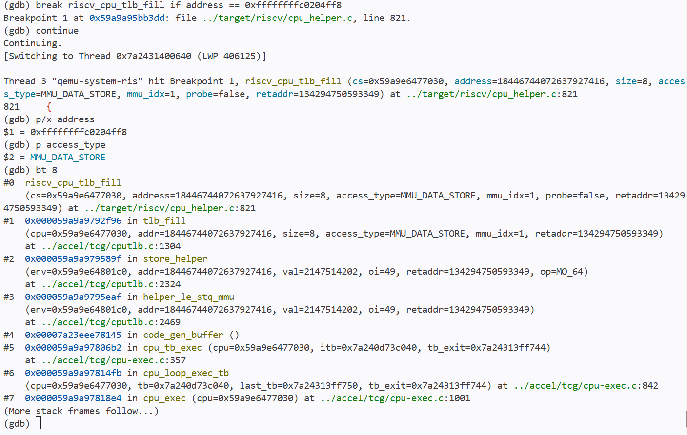

**图示说明：图 3：目标写访问命中 riscv_cpu_tlb_fill，并显示调用栈。**

##### 步骤 4：进入架构相关的页表翻译函数

```gdb
tbreak get_physical_address if addr == 0xffffffffc0204ff8
continue
p/x addr
p/x env->satp
p access_type
p mmu_idx
list
```

这里参数名由 `address` 变为 `addr`。内核 GDB 的 `$satp` 与普通 GDB 中 `env->satp` 读数一致，说明后者正在观察模拟 CPU 的对应状态。

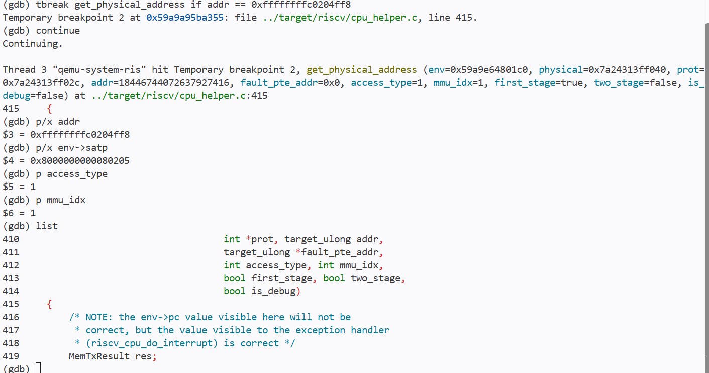

**图示说明：图 4：get_physical_address 的输入地址、satp 和访问模式。**

之后设置 `tbreak get_physical_address if addr == 0xffffffffc0204ff8`，继续进入 RISC-V 页表遍历函数。`first_stage=true`、`two_stage=false` 表明本次走普通的单阶段地址翻译路径。

#### 页表查询与物理地址计算

以下数值来自本次 GDB 会话，不是根据原理假设的输出。对应源码为 QEMU 6.2.0 的 `target/riscv/cpu_helper.c`。

| 观察位置 | 实际值 | 解释 |
|---|---|---|
| `env->satp` | `0x8000000000080205` | MODE 为 8，采用 Sv39；根页表 PPN 为 `0x80205` |
| `base` | `0x80205000` | 根页表物理地址，即 PPN 左移 12 位 |
| `levels / ptesize` | `3 / 8` | Sv39 支持三级，每项 8 字节 |
| 首轮 `i / ptshift` | `0 / 18` | 查询顶级页表，取虚拟地址的第 38～30 位 |
| `idx` | `0x1ff` | 顶级索引 511 |
| `pte_addr` | `0x80205ff8` | 根页表中第 511 项所在的物理地址 |
| `pte` | `0x200000cf` | 从该地址读出的页表项 |
| `pte >> 10` | `0x80000` | 叶子项中的物理页号 |
| `pte & 0xff` | `0xcf` | V、R、W、X、A、D 置位，U、G 为零 |
| `*physical` | `0x80204ff8` | 本次存储最终使用的客体物理地址 |

##### 步骤 5：观察根页表索引和 PTE 地址

以下文件路径属于 QEMU 源码树。终端 2 逐行执行：

```gdb
tbreak /home/heweiren/work/qemu-debug/qemu-6.2.0/target/riscv/cpu_helper.c:573
continue
p levels
p ptesize
p i
p ptshift
p/x base
p/x idx
p/x pte_addr
```

必须先执行到断点再读取局部变量。本次 `i=0` 表示遍历的第一次循环，即 Sv39 的顶级，不是底层的 VPN[0]。

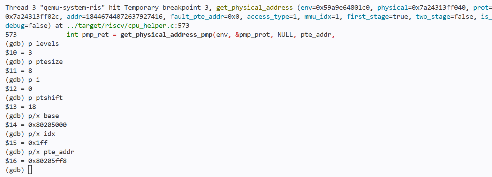

**图示说明：图 5：三级结构参数、顶级索引 511 和页表项地址。**

计算索引和页表项位置：

```text
idx = (0xffffffffc0204ff8 >> 30) & 0x1ff = 511
pte_addr = 0x80205000 + 511 × 8 = 0x80205ff8
```

在源码第 573 行停下时，`pte_addr` 已算出，接下来检查读取页表项的 PMP 权限。第 584 行通过 `address_space_ldq` 读取 64 位 PTE；停到第 591 行后，观察到 `pte=0x200000cf`。

##### 步骤 6：读取并解码 PTE

```gdb
tbreak /home/heweiren/work/qemu-debug/qemu-6.2.0/target/riscv/cpu_helper.c:591
continue
p/x pte
p/x (pte >> 10)
p/x (pte & 0xff)
```

三项实测结果依次为 `0x200000cf`、`0x80000`、`0xcf`。停在第 591 行时该行赋值尚未执行，所以直接计算 `pte >> 10`，不提前读取尚未赋值的 `ppn`。

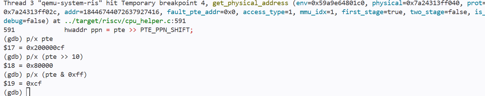

**图示说明：图 6：PTE 内容、物理页号及权限标志。**

关键分支包括：V 为零则失败；R/W/X 均为零则将其作为下一级页表指针继续查询；否则检查叶子项的权限、特权级和大页物理对齐。本次 R/W/X 均为 1，且 U 为零、访问来自 S 模式，满足写权限要求。PPN 的低 18 位为零，满足顶级大页的对齐要求。A、D 已预置，因此不需要更新这两个标志。

##### 步骤 7：验证最终物理地址

```gdb
tbreak /home/heweiren/work/qemu-debug/qemu-6.2.0/target/riscv/cpu_helper.c:675
continue
p/x ppn
p ptshift
p/x *physical
```

实测 `ppn=0x80000`、`ptshift=18`、`*physical=0x80204ff8`，这是页表翻译核心结果的直接证据。

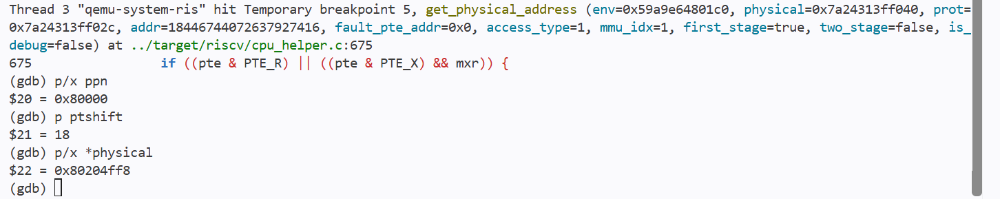

**图示说明：图 7：大页地址拼接完成后的最终物理地址。**

顶级项已经是叶子，因此它映射 1 GiB，而不是继续访问三级中的每一层。第 671～672 行将 PPN、虚拟页号低位和页内偏移拼接，在第 675 行读取到翻译结果：

```text
大页物理起点 = 0x80000 << 12 = 0x80000000
大页内偏移   = 0xffffffffc0204ff8 & 0x3fffffff = 0x204ff8
最终物理地址 = 0x80000000 + 0x204ff8 = 0x80204ff8
```

这里必须区分三个地址：`0x80205ff8` 是页表项地址，`0x80204ff8` 是被写入数据的客体物理地址，GDB 中 `physical` 指针本身则是 QEMU 的宿主地址；应查看 `*physical` 才能得到翻译结果。

#### TLB 填充参数：已实测

##### 步骤 8：查看填充参数并进入 TLB 接口

```gdb
tbreak /home/heweiren/work/qemu-debug/qemu-6.2.0/target/riscv/cpu_helper.c:941
continue
p/x address
p/x pa
p/x prot
p/x tlb_size
```

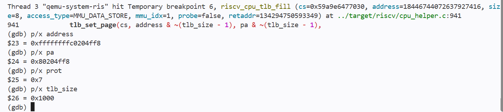

**图示说明：图 8：翻译结果、权限和 4 KiB 填充粒度。**

返回 `riscv_cpu_tlb_fill` 后，还会检查最终数据地址的 PMP 权限，并将其与页表权限相交。在第 941 行观察到：

```text
address  = 0xffffffffc0204ff8
pa       = 0x80204ff8
prot     = 0x7
tlb_size = 0x1000
```

`prot=7` 表示读、写、执行权限；`tlb_size=4096`。进入 `tlb_set_page` 后，`info args` 显示传入的是按该大小对齐的地址：

```text
vaddr = 0xffffffffc0204000
paddr = 0x80204000
size  = 4096
```

最后执行：

```gdb
tbreak tlb_set_page
continue
info args
list
```

停在 `accel/tcg/cputlb.c:1273`，即将调用 `tlb_set_page_with_attrs`。截图中的地址以十进制显示，换算后就是上述两个页起点；`size=4096`、`prot=7` 与外层观察一致。这是本轮实际调试的结束位置。

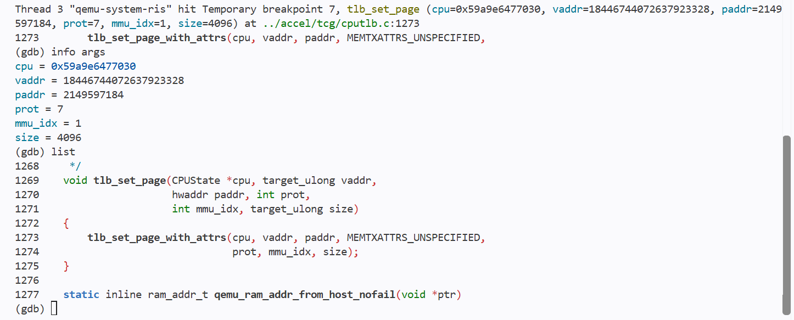

**图示说明：图 9：tlb_set_page 的实际参数及下一层填充调用。**

这说明客体页表采用 1 GiB 大页，不代表本次 QEMU 软件 TLB 填充也是 1 GiB。本次已观察到填充函数入口及其参数，未继续单步检查最终缓存槽内容，也没有把这一步描述为已验证后续命中。

#### TLB 查询分支及与硬件的区别：源码分析

在 `accel/tcg/cputlb.c` 的 `store_helper()` 中可以找到查询逻辑：先由地址和 `mmu_idx` 定位 TLB 项，读取写访问对应的标签，然后判断：

```c
if (!tlb_hit(tlb_addr, addr)) {
    if (!victim_tlb_hit(env, mmu_idx, index, tlb_off,
                        addr & TARGET_PAGE_MASK)) {
        tlb_fill(env_cpu(env), addr, size, MMU_DATA_STORE,
                 mmu_idx, retaddr);
        /* 重新取得已填充的条目 */
    }
}
```

主表不命中时先查询 victim TLB，仍不命中才进入架构相关的填充路径。本次调用栈到达了其中的 `tlb_fill`，与该慢路径一致；但未直接停在 `tlb_hit` 分支比较标签，因此这里属于结合调用栈的源码分析，不能代替手册要求的完整查询分支单步演示。另外，TCG 生成的机器码也包含快速访存路径，不能把所有命中都理解为一定调用这个 C helper。

真实 CPU 的 TLB 缓存地址翻译及权限，QEMU 的软件 TLB 还需要支持将客体访问转换成宿主 RAM 访问或 MMIO 处理，包含访问标签、宿主访问偏移等实现信息。在 `get_physical_address` 中，M 模式的适用路径或 Bare 模式可直接令物理地址等于输入地址；QEMU 仍可能使用软件 TLB 加速后续模拟访问。因此，“关闭客体分页”不等于“QEMU 不再使用软件 TLB”。这部分结论来自源码阅读，分页关闭前后的运行对照尚未完成。

#### AI 协作与调试中的问题

1. **明确版本与调试信息的区别。** 最初把指导书的 QEMU 4.1.1 与调试能力混为一谈。通过追问确认 6.2.0 同样支持构建调试版，`--enable-debug` 是 configure 参数，不是运行选项。
2. **理解两个 GDB 的控制对象。** Ctrl+C 暂停普通 GDB 时可能停在宿主 `__ppoll`，此时查询 `address` 报“当前上下文不存在”是因为尚未命中 MMU 函数，而不是参数丢失。
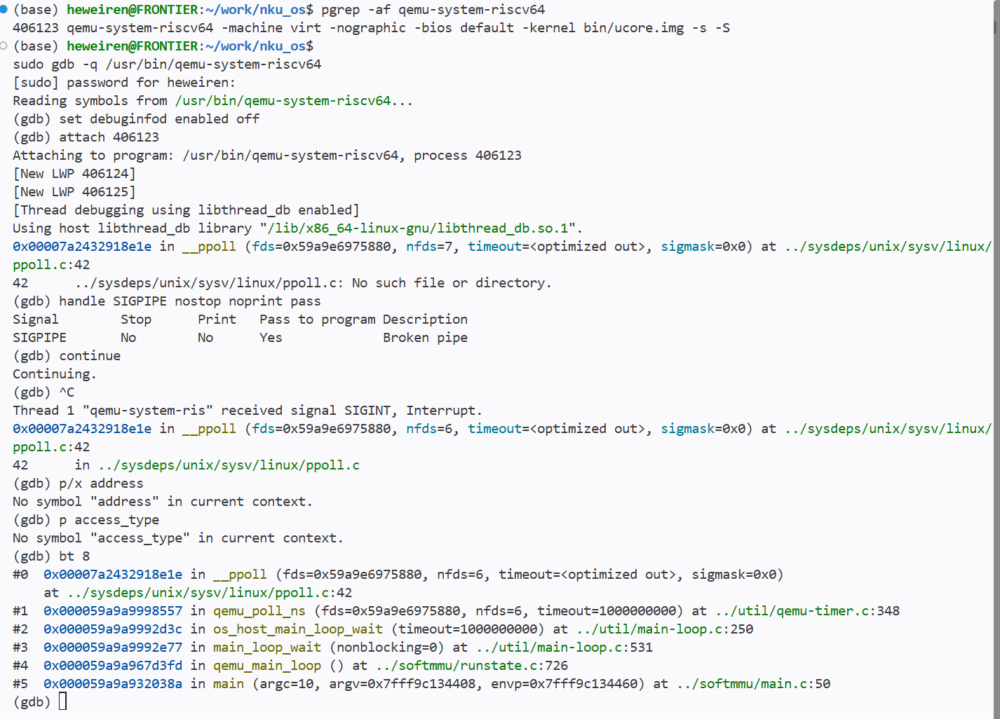

**图 10：一次有用的排错记录。** `attach` 和 Ctrl+C 只能保证 QEMU 进程暂停，不能保证它正执行地址翻译函数。截图中的栈顶为 `__ppoll`，其调用链属于 QEMU 主事件循环，所以 `address`、`access_type` 不在当前作用域。正确处理是在 `riscv_cpu_tlb_fill` 设置条件断点，恢复 QEMU，再让终端 3 单步执行目标存储；命中后的参数和调用栈见图 3。截图中的 `ppoll.c: No such file or directory` 表示宿主 libc 源码未找到，不代表 QEMU 源码调试信息缺失。

3. **区分设置断点与运行到断点。** 设置第 573 行断点后忘记 `continue`，在函数入口读取未初始化的 `levels`、`ptesize` 得到无意义数值。执行到赋值之后再观察，结果才与 Sv39 的 3 级、8 字节相符。
4. **按地址过滤断点。** 把每次地址翻译都停下会产生大量无关事件。先在内核 GDB 确认 `sp+8`，再设置条件断点，使观察对象与一条真实存储指令对应。
5. **及时限定调试范围。** 本次已得到完整的页表翻译证据，继续深入每一层填充封装并非必要。报告将已实测、源码分析和待补实验分开，避免用推测补全结果。

---

## 五、测试与验证

<!-- 根据该实验的具体情况，提供完整的测试运行截图，应包含：
- 编译及运行成功的输出（make qemu），可能有多个
- 测试通过的结果（make grade），只有一个
-->

### 验证范围

| 项目 | 已有证据 | 说明 |
|---|---|---|
| First-Fit | 本机 `make qemu` 输出 `default_pmm_manager` 和自检成功 | 修复启动参数后实测 |
| Best-Fit | 下方队友提供的 6/6 自检和 20/20 评分截图 | 保留原环境验证记录，不将其当作 Buddy 成绩 |
| Buddy | 单文件交叉编译、宿主侧带检查器自检、QEMU 6.2.0 启动并输出自检成功 | 使用独立描述符测试核心算法，不声称已完成真实 RAM 压力测试 |
| QEMU/MMU | 双 GDB 会话中实际观察 PTE、翻译结果与填充参数 | 查询命中分支与 Bare 模式对照仍待补充实测 |

Buddy 的内核运行输出摘录如下：

```text
memory management: buddy_pmm_manager
physical memory map:
  memory: 0x0000000008000000, [0x0000000080000000, 0x0000000088000000).
check_alloc_page() succeeded!
satp virtual address: 0xffffffffc0205000
satp physical address: 0x0000000080205000
```

本次 GDB 原始截图已保存至 `images/mmu_01_entry.png`～`images/mmu_10_context_error.png`，并穿插在分支任务对应步骤中。图 1～9 展示从内核入口到 TLB 填充接口的观察过程，图 10 记录上下文错误及其排查。图片直接复制自本次实验截图，未重绘或修改输出。

**已有测试截图：**

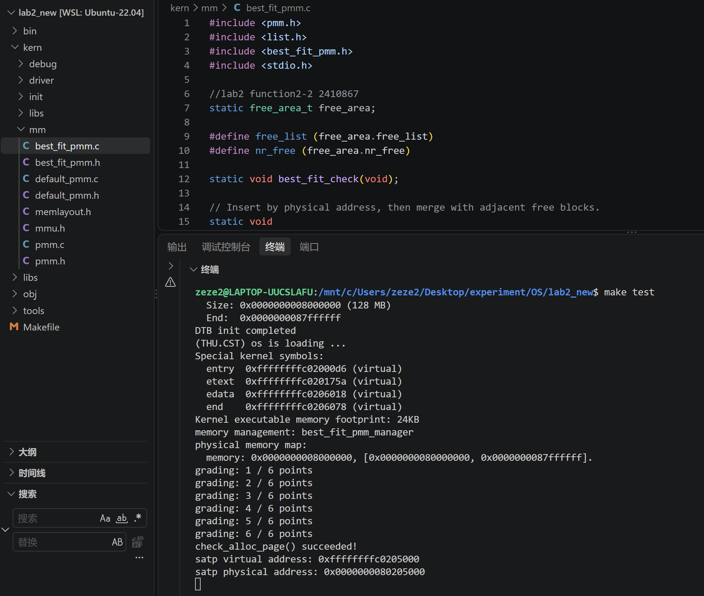
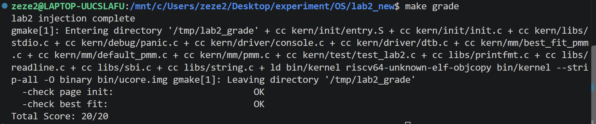

---

## 六、实验总结与收获

### 对操作系统的理解

#### 重要知识点及其与 OS 原理的联系

| 知识点 | OS 原理中的含义 | 本实验中的对应内容及区别 |
|------|------|------|
| 分页与地址空间 | 页表记录虚拟页到物理页的映射，使程序使用的地址与实际内存位置分离 | 框架利用 Sv39 启动页表运行高地址内核；当前采用固定偏移的直接映射和根级大页，尚未实现每个用户进程独立的页表管理 |
| 物理内存发现与保留 | 操作系统必须先知道真实 RAM 的范围及用途，再建立可分配资源集合 | 从 DTB 获取内存范围，用 `page_init()` 排除 OpenSBI 保留区、内核、描述符数组和不完整页面；实验针对固定平台，真实系统还需处理多个内存区间和更多保留项 |
| 管理元数据 | 分配器需要用额外的数据记录资源状态，这部分数据本身也消耗资源 | `Page` 数组描述物理页，但数组自身占用的页面必须保留；这说明管理开销也是内存布局的一部分 |
| 连续分配与外部碎片 | 空闲容量足够不代表存在足够大的连续区间 | First-Fit 选择第一个合适块，Best-Fit 选择最小合适块；两者都依赖分裂和相邻合并，Best-Fit 也不能保证消除外部碎片 |
| Buddy 与内部碎片 | 按 2 的幂次组织块可简化分裂和伙伴定位，但向上取整可能浪费空间 | Buddy 任务要求明确非 2 的幂请求、初始区间拆分和释放规则；其主要取舍是块组织方式与空间利用率之间的平衡 |
| TLB 与局部性 | 缓存地址转换结果可以减少页表遍历开销，映射变化后还需要保证缓存一致性 | 启动代码使用 `sfence.vma`；分支调试任务关注 QEMU 中的访存和转换路径。模拟器的软件缓存还服务于宿主内存访问，不能与真实硬件 TLB 完全等同 |
| 机制与策略分离 | 稳定接口负责提供能力，具体算法决定资源如何选择和组织 | `pmm_manager` 允许在统一接口下替换 First-Fit、Best-Fit 或 Buddy；上层调用形式可以保持一致，但每种算法仍需明确分配和释放的契约 |

这一实验使我们认识到，内存管理的正确性并不只取决于“能否返回一个地址”。一个正确的分配器还必须保证已分配区间互不重叠、保留页不被分配、空闲统计准确、释放后状态可恢复，以及连续区间的边界和状态标志相互一致。初始化时一处地址或页数计算错误，也可能在后续多次分配后才表现为内存破坏。

#### OS 原理中重要但本实验尚未完整涉及的内容

1. **按需分页和页面置换。** 本实验主要管理驻留物理内存，尚未实现缺页异常触发的装页、换入换出，以及 FIFO、LRU、Clock 等置换策略。
2. **进程级虚拟地址空间。** 当前重点是内核启动映射和物理页分配，没有完整实现用户页表、进程间地址隔离、写时复制以及共享内存。
3. **并发内存管理。** 当前实验环境较简单，尚未完整处理多核同时分配和释放时的同步、每 CPU 缓存、跨核 TLB 一致性等问题。
4. **复杂硬件内存组织。** 真实系统还可能存在 NUMA、DMA 地址限制、内存空洞、热插拔和不同内存区域，不能直接套用本实验单段内存的假设。
5. **完整内存保护与生命周期管理。** 教学代码中的页状态和断言只覆盖部分约束，更完善的系统还需要协调权限控制、引用计数、对象生命周期，以及重复释放和越界访问的检测。

### AI 协作开发的经验

1. **先理解状态约定，再让 AI 补代码。** `npage` 看起来像“页面数量”，实际却是物理页号上界；描述符数量应为 `npage - nbase`。如果只根据变量名猜测含义，生成的代码很容易在布局阶段出错。提示词中的依赖信息必须从真实源码确认。

2. **四段式提示词帮助把需求变成可检查的约束。** `[PROMPT]` 明确任务与修改范围，`[RELY]` 提供已有接口和数据结构，`[GUARANTEE]` 列出交付内容，`[SPECIFICATION]` 则说明正常路径和边界情况。对于 Best-Fit，空链表、总量足够但连续块不足、精确匹配、分裂和两侧合并都应单独考虑。

3. **验证算法要看具有区分度的测试。** 只观察分配成功无法判断运行的是 First-Fit 还是 Best-Fit。构造“前面有 2 页块、后面有 1 页块，再申请 1 页”的场景，才能直接区分两种策略。对于 Buddy，也应由行为规格出发设计测试，避免仅重复实现中的判断。

4. **通过测试需要结合测试实际覆盖范围解释。** `make test` 的分配器断言与 `make grade` 的评分检查承担不同职责。已有的 6/6 和 20/20 证明当前实现通过了相应检查，但不能代替所有异常输入测试，也不能作为 Buddy 或分支调试任务已完成的证明。

5. **出现异常时应先定位执行阶段。** 两名成员都遇到过启动停在固件输出的现象，但处理记录不能混为一谈。于润泽使用指导书示例版本重新验证；邢陶清在 QEMU 6.2.0 中发现 OpenSBI 的下一阶段地址为 0，参考 Lab1 将镜像加载参数改为 `-kernel` 后启动成功，无需降级。应结合具体日志定位问题，而不能仅根据版本号判断原因。

6. **AI 输出需要人工核对，也需要保留真实验证记录。** 除了检查编译和运行结果，还应检查管理器是否真正切换、教师测试是否保留、报告提示词是否与最终代码一致。对以后可能改进的方案，应与已经完成并验证的实现区分开。

---