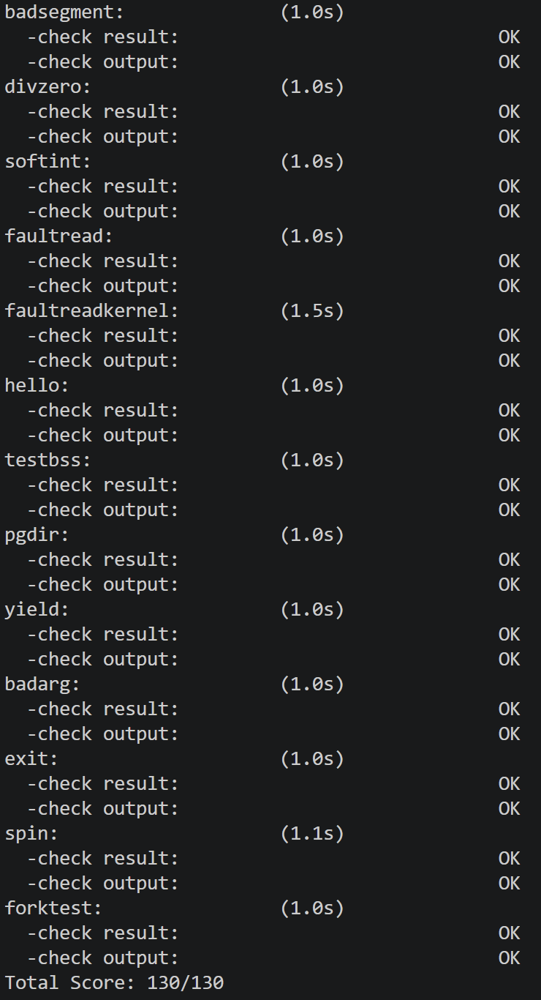

# 操作系统实验报告

## 实验基本信息

| 项目 | 内容 |
|------|------|
| **实验名称** | Lab 5：用户程序 |
| **小组成员** | 2413802-邢陶清、2410867-于润泽 |
| **完成日期** | 2026-11-25 |

### 小组分工

**练习分工：**

| 成员 | 负责的练习/模块 |
|------|----------------|
| 2413802-邢陶清 | 功能模块四，扩展练习Challenge，分支任务 |
| 2410867-于润泽 | 功能模块一，功能模块二，功能模块三 |

**实验报告分工：**

| 成员 | 负责的报告内容 |
|------|----------------|
| 2413802-邢陶清 | 本人负责的任务及相关分析 |
| 2410867-于润泽 | 整体框架、实验目的、整体逻辑分析、总结与收获及本人负责的任务 |

---

## 一、实验目的

本实验在已有物理内存管理、异常处理和内核线程调度的基础上，使 ucore 能够启动并管理在 RISC-V U 态运行的程序。主要目标如下。

1. 理解用户态与内核态的权限划分，掌握 `ecall` 触发异常、内核保存和恢复 `trapframe`、`sret` 返回用户态的过程，能够说明系统调用编号、参数和返回值在寄存器中的传递关系。
2. 掌握第一个用户进程的启动过程，理解 `idleproc`、`initproc` 与 `user_main` 的关系，以及 ELF 程序头、用户页表、用户栈和初始执行现场如何共同决定程序的运行位置和权限。
3. 理解 `fork` 与 `exec` 的语义。实现子进程控制块、内核栈、执行现场和用户地址空间的准备，解释父子进程的不同返回值，以及程序映像替换时进程身份和地址空间的变化。
4. 掌握 `exit`、`wait`、`yield`、`kill` 与调度器的配合，理解僵尸进程、孤儿进程、阻塞与唤醒和分阶段资源回收，能追踪进程从创建到被父进程回收的完整过程。
5. 结合实验自检与自动评分，使用正常启动、非法访问、错误参数和多进程等用例验证实现。练习用 Lab 0.5 的四段式提示词描述工程依赖、接口和可检查的行为规格。

---

## 二、实验环境

你们使用的 AI 工具

| 成员 | AI 编程工具 | 底层模型 | 备注 |
|------|------------|---------|------|
| 2413802-邢陶清 | Codex | GPT-6.2 |
| 2410867-于润泽 | Codex | GPT-6.2 |

---

## 三、实验整体逻辑分析

### 3.1 本章节的逻辑主线

Lab 5 的主线是让用户程序在独立的地址空间中执行，并由内核统一管理用户程序的启动、运行和结束。Lab 2 提供物理页分配和页表操作，Lab 3 提供异常入口与返回，Lab 4 提供进程控制块、内核栈和调度。Lab 5 将这些能力接到同一条执行链上。物理页分配器为程序段和栈提供页面，页表决定用户能访问的位置和权限，调度器在切换进程时切换页表和内核执行现场。

这条主线包含两种特权级切换。内核启动首个用户程序时，先为 ELF 建立页表和用户栈，再构造初始 `trapframe`，通过 `sret` 第一次进入 U 态。用户程序运行后，调用 `fork`、`waitpid` 或 `cprintf` 等接口会通过 `ecall` 进入 S 态。内核使用当前进程的内核栈保存现场，根据系统调用号执行内核操作，再通过 `sret` 恢复用户态。若本次调用需要阻塞、退出或让出 CPU，调度器会在合适的位置接管执行。

```text
系统启动     proc_init → idleproc → initproc 执行 init_main
程序装入     user_main → kernel_execve → do_execve → load_icode
首次进 U 态  forkrets → __trapret → sret → _start → umain → main
请求内核     用户库 → ecall → __alltraps → trap → exception_handler → syscall
进程管理     fork 生成子进程 | exec 替换程序映像 | yield 请求调度
退出回收     exit 生成僵尸进程 | kill 请求目标退出 | wait 回收僵尸进程
```

实现中要同时跟踪三类状态。`trapframe` 记录跨特权级返回所需的寄存器和程序计数器，`context` 记录调度切换后从哪里继续执行内核代码，`mm_struct` 与页表则描述该进程可见的地址空间。以 `fork` 为例，复制用户页让子进程看到与父进程相同的初始数据，设置 `context` 使子进程首次获得 CPU 时能走返回路径，修改子进程 `trapframe` 才使它从同一条 `fork` 后得到返回值 0。三个层面配合后，用户程序才能观察到正确的进程语义。

### 3.2 功能的逐步实现

1. **先接通系统调用路径。** 在 `trapentry.S` 中完善用户栈与内核栈的切换和双向恢复，在 `exception_handler` 中识别 U 态 `ecall`，再由 `syscall` 建立寄存器约定和服务分发。后续进程管理功能都通过这一入口对用户程序开放，因此首先要约定编号、参数、返回值和异常返回位置。
2. **再启动真实的用户程序。** 由 `initproc` 创建运行 `user_main` 的过渡内核线程。装载器为它建立新的页表，按 ELF 的 `PT_LOAD` 装入映像，设置用户栈和入口现场，接上 `sret`。运行到 `hello` 的用户态输出时，可以连贯地观察首次进入 U 态、再次陷入内核和返回用户态的过程。
3. **在已有用户进程上实现复制。** `do_fork` 负责子进程的 PCB、内核栈、PID 和进程关系。`copy_mm`、`dup_mmap` 与 `copy_range` 分别处理地址空间选择、虚拟区间和物理页。子进程完全准备好之后才成为可运行状态。通过 `forktest` 等用例，可以观察同一个程序如何产生多个可独立执行和退出的进程。
4. **补齐进程控制和回收。** `yield` 提出调度请求，`kill` 设置退出标志并唤醒可以中断的等待，`exit` 释放地址空间并留下退出状态，`wait` 负责收取结果和完成回收。`exit` 用例验证退出码与重复等待，`spin` 用例将定时器抢占与 `kill`、`wait` 连在一起，便于检查进程在自旋时能否被终止。

手册按这四个模块组织练习。实际跑通用例时，需要把相邻模块连起来检查。例如 `init_main` 创建用户进程后会等待它退出，`do_wait` 若只实现睡眠而缺少退出方唤醒，就会卡在启动链的末端。把系统调用和调度分别理解，再通过父子进程的执行过程检查接口衔接，可以定位问题发生在陷入、装载、切换还是回收阶段。


---

## 四、实验内容与实现

### 练习：[功能模块一：用户态系统调用功能]

**负责人：** [2410867-于润泽]

#### 模块功能描述

**需要实现或修改的函数**

```c
// kern/trap/trap.c
void exception_handler(struct trapframe *tf);

// kern/syscall/syscall.c
void syscall(void);
static int sys_exit(uint64_t arg[]);
static int sys_fork(uint64_t arg[]);
static int sys_wait(uint64_t arg[]);
static int sys_exec(uint64_t arg[]);
static int sys_yield(uint64_t arg[]);
static int sys_kill(uint64_t arg[]);
static int sys_getpid(uint64_t arg[]);
static int sys_putc(uint64_t arg[]);
static int sys_pgdir(uint64_t arg[]);
```

**功能说明**

用户库按照实验 ABI 将系统调用号放入 `a0`，将最多五个参数放入 `a1` 至 `a5`，再执行 `ecall`。处理器记录异常原因与返回位置并跳到 `stvec` 指定的入口。`__alltraps` 用 `sscratch` 取得内核栈，将通用寄存器和异常相关 CSR 保存为 `trapframe`。`trap` 在分发期间把这次现场挂在 `current->tf`，供系统调用层和进程管理层使用。内核态自身发生陷入时继续使用原内核栈，返回用户态时则需为下一次陷入重新在 `sscratch` 中保存内核栈顶。

`exception_handler` 识别 `CAUSE_USER_ECALL`，在分派之前将保存的 `epc` 加 4，使正常返回从 `ecall` 的下一条指令继续。`syscall` 先检查编号是否落在分发表内、对应表项是否存在，再读取参数并调用 `sys_*`。越界或空表项返回 `-E_INVAL`。其他用户异常会打印现场并使当前进程退出，父进程仍可通过等待路径完成回收。

各 `sys_*` 完成参数到内核接口的转换。`sys_fork` 将当前 trapframe 和用户栈指针交给 `do_fork`，使子进程能从已前移的入口继续执行。`sys_wait` 和 `sys_exec` 传递用户指针，由 `do_wait`、`do_execve` 在读写之前检查 VMA 与实际页表权限。`sys_getpid` 直接读取当前进程 PID，`sys_putc` 输出一个字符，`sys_pgdir` 列出当前页表中的用户映射。普通调用的结果写回 `a0`，由异常返回代码恢复到用户寄存器。

#### 最终提示词

````markdown
[PROMPT]
**任务**
在 RISC-V ucore Lab 5 中实现用户态系统调用模块。修改 kern/trap/trap.c
中的异常处理，以及 kern/syscall/syscall.c 中的查表分派和系统调用适配函数。

**操作要求**
在项目实际文件的 Lab 5 模块一位置补全函数。沿用用户库、异常入口和已有
调度协议，保留教师用例。可以增加模块内部 static 辅助函数。

**输出要求**
完成下列接口并检查它们与当前工程声明、系统调用号和异常返回路径的一致性。

[RELY]
- libs/unistd.h 定义 SYS_exit、SYS_fork、SYS_wait、SYS_exec、SYS_yield、
  SYS_kill、SYS_getpid、SYS_putc、SYS_pgdir。user/libs/syscall.c 的内联
  汇编约定 a0 为调用号，a1 至 a5 为参数，返回后从 a0 取结果。
- struct trapframe 提供 gpr、epc、cause、status。trap() 在分派期间将该帧
  放入 current->tf，trap_in_kernel() 根据已保存的 SSTATUS_SPP 判别来源。
- CAUSE_USER_ECALL 表示用户态环境调用。系统调用表类型为 int (*)(uint64_t [])，
  NUM_SYSCALLS 表示表项数，表内可能有未注册的编号。
- 可依赖 do_exit、do_fork、do_wait、do_execve、do_yield、do_kill、
  cputchar、print_pgdir、print_trapframe。涉及用户缓冲区的检查由对应
  do_* 接口完成。

[GUARANTEE]
必须实现或修改的接口
```c
void exception_handler(struct trapframe *tf);
void syscall(void);
static int sys_exit(uint64_t arg[]);
static int sys_fork(uint64_t arg[]);
static int sys_wait(uint64_t arg[]);
static int sys_exec(uint64_t arg[]);
static int sys_yield(uint64_t arg[]);
static int sys_kill(uint64_t arg[]);
static int sys_getpid(uint64_t arg[]);
static int sys_putc(uint64_t arg[]);
static int sys_pgdir(uint64_t arg[]);
```

[SPECIFICATION]
## exception_handler
**Pre-Condition**
- tf 保存本次异常的现场。对用户态 ecall，current->tf 指向同一帧。

**Post-Condition**
- 用户态 ecall 的现场可供 syscall 使用。若调用返回，epc 指向 ecall 后一条指令。

  **Case 1** 用户态 ecall，先将 epc 增加 4，再调用 syscall()。

  **Case 2** 其他用户态异常，打印现场并进入该用户进程的退出路径。

  **Case 3** 未处理的内核态异常，打印现场并交给内核错误处理。

## syscall
**Pre-Condition**
- current->tf 有效，其通用寄存器内保留用户库提交的编号和参数。

**Post-Condition**
- 正常返回时，gpr.a0 可作为用户可见返回值，epc 沿用异常处理器已确定的位置。

  **Case 1** 编号有效且表项存在。依次从 a1 至 a5 取参，调用相应处理函数，
  将其返回值写回同一帧的 a0。

  **Case 2** 编号越界或表项为空。在访问有效处理函数前完成检查，返回 -E_INVAL。

  **Case 3** 调用使进程退出或更换程序。退出按进程管理路径结束，成功 exec
  后按已更新的用户现场运行新的入口。

## sys_exit、sys_fork、sys_wait、sys_exec
**Pre-Condition**
- 分发表已完成编号检查。参数按注册入口的 ABI 准备。

**Post-Condition**
- sys_exit 以 arg[0] 作为退出码。sys_fork 以普通 fork 方式传入当前帧和
  当前用户 sp。sys_wait 传递 PID 与退出码存放地址。sys_exec 依次传递
  名称指针、名称长度、ELF 缓冲区指针和缓冲区长度。

**Requirements**
- 适配函数保持 do_* 的返回值语义。用户指针由进程管理层检查后再访问。

## sys_yield、sys_kill、sys_getpid、sys_putc、sys_pgdir
**Pre-Condition**
- current 对应发起本次调用的进程，arg[] 可读取该调用约定的参数。

**Post-Condition**
- yield 转交调度请求，kill 转交指定 PID，getpid 返回当前 PID。
- putc 向控制台写出一个字符，pgdir 调用已有页表打印接口。两项成功返回 0。

**Requirements**
- 沿用 ucore 实验 ABI，核对 test_lab5.c 对 getpid、非法编号和 epc 的检查。
- 通过 hello、pgdir、badarg 验证用户输出、页表服务和用户指针错误返回。
````


---

### 练习：[功能模块二：创建加载第一个用户进程功能]

**负责人：** [2410867-于润泽]

#### 模块功能描述

**需要实现或修改的函数**

```c
// kern/process/proc.c
void proc_init(void);
static struct proc_struct *alloc_proc(void);
int kernel_thread(int (*fn)(void *), void *arg, uint32_t clone_flags);
static int init_main(void *arg);
static int user_main(void *arg);
static int kernel_execve(const char *name, unsigned char *binary, size_t size);
int do_execve(const char *name, size_t len, unsigned char *binary, size_t size);
static int load_icode(unsigned char *binary, size_t size);
int do_wait(int pid, int *code_store);
```

**功能说明**

`proc_init` 建立进程链表和 PID 哈希桶，初始化 PID 为 0 的 `idleproc`，再创建 PID 为 1 的 `initproc`。`init_main` 创建新的内核线程执行 `user_main`，自己承担等待和回收的职责。`alloc_proc` 为进程字段设置确定的初始值，`kernel_thread` 构造进入 `kernel_thread_entry` 的初始 S 态现场，复用 `do_fork` 完成创建。这使系统可以先使用已有的内核调度功能，再把被调度的过渡线程转换为用户进程。

`user_main` 通过 `KERNEL_EXECVE` 或 `KERNEL_EXECVE2` 取得镜像内 ELF 的起址与长度。默认选择 `exit`，评分构建根据 `TEST`、`TESTSTART`、`TESTSIZE` 选择用例。`kernel_execve` 在内核栈顶准备 trapframe 并调用 `do_execve`。已有用户映像需要替换时，`do_execve` 先验证参数，并将来源于旧用户空间的 ELF 字节保存在内核缓冲区，随后解除对旧 `mm` 的引用。成功装载后更新进程名称，PID 与进程关系沿用当前 PCB。

`load_icode` 检查 ELF 头和程序头的范围，为 `PT_LOAD` 段登记 VMA，并按程序头标志设置用户页的读、写、执行权限。可写段同时设置读权限，以满足 Sv39 的页表权限编码。每个段的 `p_filesz` 给出文件字节长度，`p_memsz` 给出内存大小。页内有文件内容的部分从 ELF 拷贝，其余部分保持为零，满足 BSS 初始状态。用户栈在 `USTACKTOP` 下预留栈 VMA，先为栈顶 4 页分配物理页。设置用户 `sp`、入口 `epc` 和返回所需的 `sstatus`，再由 `forkrets` 进入 `__trapret`，通过 `sret` 从用户 `_start` 执行。装载途中遇到错误时，先清理已经创建的映射和页表。

`do_wait` 把启动后的执行链收束起来。对于指定 PID，只检查自己的对应子进程。PID 为 0 时，从子进程链表寻找可回收的子进程。当前没有僵尸子进程但还有匹配子进程时，父进程以 `WT_CHILD` 等待。子进程变为僵尸后，父进程可以取得退出码，再摘除子进程并释放其内核栈和 PCB。`init_main` 循环等待直至所有子进程和被接管的孤儿完成回收，检查进程关系与可用内存是否恢复。

#### 最终提示词

````markdown
[PROMPT]
**任务**
在 kern/process/proc.c 中完成从内核线程创建、内嵌 ELF 装载到首次进入 U 态的
启动流程，并实现供 initproc 和用户程序共同使用的等待与回收接口。

**操作要求**
在项目实际文件内补全相关函数。沿用项目已有的进程、页表、ELF 和异常返回定义，
按需使用模块内部 static 辅助函数。保持已有测试程序和镜像的构建规则。

**输出要求**
完成下列接口，检查默认用户程序和使用 TEST 宏选定的用户程序都能进入 U 态，
并在用户程序退出后完成等待和回收。

[RELY]
- proc_struct 中的 state、pid、parent、cptr、optr、yptr、kstack、mm、pgdir、
  tf、context、wait_state 和 exit_code。可调用 set_proc_name、hash_proc、
  find_proc、unhash_proc、remove_links、put_kstack、wakeup_proc 和 schedule。
- kernel_thread_entry 接收初始帧中的 s0、s1 作为函数和参数，do_fork 支持
  CLONE_VM。forkrets 接收内核栈上的 trapframe，并进入已有 __trapret。
- elfhdr、proghdr、ELF_MAGIC、ELF_PT_LOAD、ELF_PF_R/W/X 来自 libs/elf.h。
  KERNEL_EXECVE 和 KERNEL_EXECVE2 提供镜像内 ELF 字节的起址与长度。
- mm_create、setup_pgdir、mm_map、pgdir_alloc_page、get_pte、exit_mmap、
  put_pgdir、mm_destroy 负责地址空间。user_mem_check 检查范围与 VMA 权限。
- KSTACKSIZE、PGSIZE、USERBASE、USTACKTOP、USTACKSIZE、VM_STACK、
  PTE_U/R/W/X/V、SSTATUS_SPP/SPIE/SIE/SUM 和 boot_pgdir_pa 采用工程定义。

[GUARANTEE]
必须实现或修改的接口
```c
void proc_init(void);
static struct proc_struct *alloc_proc(void);
int kernel_thread(int (*fn)(void *), void *arg, uint32_t clone_flags);
static int init_main(void *arg);
static int user_main(void *arg);
static int kernel_execve(const char *name, unsigned char *binary, size_t size);
int do_execve(const char *name, size_t len, unsigned char *binary, size_t size);
static int load_icode(unsigned char *binary, size_t size);
int do_wait(int pid, int *code_store);
```

[SPECIFICATION]
## alloc_proc、proc_init、kernel_thread
**Pre-Condition**
- 物理内存与内核对象分配已经初始化，内核栈和启动页表可用。

**Post-Condition**
- alloc_proc 返回初始化后的 PCB，默认状态为 PROC_UNINIT，PID 尚未分配，
  内核线程使用启动页表，进程关系和等待字段处于初始状态。
- proc_init 建立 PID 为 0 的 idleproc 和 PID 为 1 的 initproc。kernel_thread
  将函数、参数和内核态入口写入初始帧，并经 do_fork 创建可调度的线程。

  **Case 1** 创建成功，返回新线程 PID，随后可经 kernel_thread_entry 执行 fn(arg)。

  **Case 2** PCB 分配失败返回 NULL，线程创建失败返回负错误码。启动必需的
  idleproc 或 initproc 无法创建时，报告初始化错误。

## init_main、user_main、kernel_execve
**Pre-Condition**
- initproc 已经可运行，内核镜像内有可用的用户 ELF 链接符号。

**Post-Condition**
- init_main 创建 user_main 并等待其子进程及接管的孤儿完成回收。
- user_main 根据 TEST 选择目标 ELF。kernel_execve 使用当前内核栈顶的
  trapframe 完成装载，成功时经 forkrets、__trapret 和 sret 进入 U 态。

**Requirements**
- initproc 保持系统进程身份。子进程全部回收后，核对进程列表和可用内存，
  可用内存同时计入物理页分配器与内核小块分配器的空闲容量。

## do_execve、load_icode
**Pre-Condition**
- current 及其用于异常返回的 trapframe 有效。ELF 来源可以是内核镜像
  中的字节段，也可以是当前用户空间传入的字节数组。

**Post-Condition**
- 装载成功时，新的 mm、用户页表和 trapframe 一致，入口可执行，用户栈可用，
  epc 取 ELF 入口，sp 取 USTACKTOP，返回到 U 态后允许正常响应中断。

  **Case 1** 参数检查失败或暂存空间不足。检查实际页及对应权限，返回相应
  错误。需要从旧用户地址空间复制的名称和 ELF 字节应在切换页表前准备好。

  **Case 2** ELF 有效且资源足够。仅装载 PT_LOAD，按程序头建立映射，拷贝
  有文件内容的字节，其余范围清零。登记栈 VMA 并映射顶端四页。成功后安装
  新页表并更新进程名称，设置 SPP=0、SPIE=1、SIE=0 的返回现场。

  **Case 3** ELF 头、程序头、段长度、段范围或入口权限无效，或者中途无法分配
  页面。清理已分配的页面、页表、VMA 和临时缓冲区；旧程序映像已解除时，
  进入当前进程的退出路径。

**Requirements**
- 用镜像长度限制所有文件内的读取，检查页对齐后的段重叠和用户栈区边界。
- 降低旧 mm 的引用计数，仅在最后一个使用者离开后销毁其用户映射和页表。

## do_wait
**Pre-Condition**
- 当前进程尝试等待自己的子进程。code_store 可为空，非空时需能写入一个 int。

**Post-Condition**
- 成功时至多回收一个僵尸子进程，返回 0，并在请求时提供退出码。

  **Case 1** 参数地址非法，返回 -E_INVAL。指定 PID 无匹配子进程，或 PID 为 0
  且无子进程，返回 -E_BAD_PROC。

  **Case 2** 匹配子进程已退出。保存退出码，解除哈希及进程树关系，释放其内核栈和 PCB。

  **Case 3** 存在匹配子进程但尚未退出。设置 PROC_SLEEPING 与 WT_CHILD，交给调度器，
  被唤醒后重新检查状态。当前进程已被请求终止时，结束等待并进入退出路径。

**Requirements**
- 子进程检查、父进程睡眠及摘链使用本实验的中断临界区约定。
- 通过 hello、testbss、exit 和 badarg 检查首个用户进程、BSS、退出码和非法指针。
````


---

### 练习：[功能模块三：复制用户进程功能]

**负责人：** [2410867-于润泽]

#### 模块功能描述

**需要实现或修改的函数**

```c
// kern/process/proc.c
int do_fork(uint32_t clone_flags, uintptr_t stack, struct trapframe *tf);
static int copy_mm(uint32_t clone_flags, struct proc_struct *proc);
static void copy_thread(struct proc_struct *proc, uintptr_t esp, struct trapframe *tf);

// kern/mm/vmm.c
int dup_mmap(struct mm_struct *to, struct mm_struct *from);

// kern/mm/pmm.c
int copy_range(pde_t *to, pde_t *from, uintptr_t start, uintptr_t end, bool share);
```

**功能说明**

`do_fork` 创建子进程并协调其资源的准备与登记。子进程具有自己的 PCB 和内核栈，`parent` 指向当前进程。完成地址空间和执行现场准备后，在中断临界区内分配 PID、登记哈希及进程树关系，再将子进程置为可运行。这样的顺序使调度器只会选择已经具备完整运行条件的子进程。如果途中失败，按已经取得的资源逆序释放。

地址空间复制分三层。`copy_mm` 选择使用启动页表、共享父进程的 `mm` 或建立独立的 `mm`。普通用户态 `fork` 走独立地址空间分支，建立新根页表并复用内核映射，在父进程地址空间锁保护下复制用户区。`dup_mmap` 以 VMA 为单位保留原区间和保护属性。`copy_range` 以页为单位，只复制源端有效的用户映射。新页内容和原页相同，虚拟地址以及读、写、执行等权限沿用原映射，物理页独立，因此后续对私有数据的写入互不影响。栈 VMA 中尚未映射的区间继续保持未映射。

`copy_thread` 将源 trapframe 复制到新内核栈顶，把子进程保存的 `a0` 设为 0，并准备首次调度使用的 `context`。用户态子进程沿用传入的用户栈指针，内核线程首跑使用它自己的内核栈。父进程通过 `do_fork` 得到新的 PID，子进程经 `forkret`、`forkrets` 和 `sret` 从保存的程序计数器继续执行。对用户态 `fork`，该位置已经由模块一推进到 `ecall` 的后一条指令。

| 场景 | 地址空间处理 | 资源回收方式 |
| --- | --- | --- |
| 内核线程的父进程没有用户 `mm` | 保持 `mm` 为空，使用启动页表 | 退出时由等待者回收自己的内核栈和 PCB |
| `clone_flags` 包含 `CLONE_VM` | 共享父进程 `mm` 并增加 `mm_count` | 最后一个引用释放后再销毁用户映射 |
| 普通用户 `fork` | 建立新的 `mm`，复制 VMA 和已映射页 | 每个进程按各自的地址空间生命周期回收 |

#### 最终提示词

````markdown
[PROMPT]
**任务**
在 kern/process/proc.c、kern/mm/vmm.c 和 kern/mm/pmm.c 中实现用户进程复制。
复用上一实验的内核线程创建框架，使普通 fork 产生可以独立运行的用户子进程。

**操作要求**
在实际文件的 Lab 5 模块三位置补全代码。沿用项目已有的 PID、进程树、内核栈、
地址空间引用计数和页表接口，使用现有调度器与测试程序。

**输出要求**
完成进程级、VMA 级和页面级的接口，明确父子返回值、成功登记时机和失败回收语义。

[RELY]
- proc_struct 的 parent、cptr、optr、yptr、context、tf、mm、pgdir、kstack。
  alloc_proc、setup_kstack、put_kstack、get_pid、hash_proc、set_links、
  wakeup_proc 对应 PCB、栈、PID、进程关系和可运行状态管理。
- MAX_PROCESS 限制进程数，CLONE_VM 表示共享整个地址空间。mm_count_inc
  维护 mm 使用者数。boot_pgdir_pa 供没有用户 mm 的内核线程使用。
- mm_create、setup_pgdir、lock_mm、unlock_mm、exit_mmap、put_pgdir、
  mm_destroy 用于地址空间的创建、保护和回收。
- struct vma_struct 包含 vm_start、vm_end、vm_flags。可使用 vma_create 和
  insert_vma_struct 构造有序的 VMA 链表。页表操作依赖 get_pte、pte2page、
  page2kva、alloc_page、free_page、page_insert，以及 PGSIZE、PTSIZE、PTE_USER。
- trap_in_kernel、forkret、forkrets 和 __trapret 提供子进程首次运行路径。

[GUARANTEE]
必须实现或修改的接口
```c
int do_fork(uint32_t clone_flags, uintptr_t stack, struct trapframe *tf);
static int copy_mm(uint32_t clone_flags, struct proc_struct *proc);
static void copy_thread(struct proc_struct *proc, uintptr_t esp, struct trapframe *tf);
int dup_mmap(struct mm_struct *to, struct mm_struct *from);
int copy_range(pde_t *to, pde_t *from, uintptr_t start, uintptr_t end, bool share);
```

[SPECIFICATION]
## do_fork、copy_thread
**Pre-Condition**
- current 和父进程执行现场有效。用户态 fork 的 epc 已指向 ecall 后的指令。

**Post-Condition**
- 成功时子进程具有独立 PCB、内核栈、PID 和上下文，能被正常调度。
  父进程获得子 PID，子进程首次返回时 a0 为 0。

  **Case 1** 资源准备成功。进程关系、PID 哈希和可运行状态在中断临界区内完成登记，
  子进程首次调度从 forkret 开始。用户态子进程使用传入的用户栈指针。

  **Case 2** 达到进程上限或分配失败。返回相应负错误码，释放已取得的资源，
  进程表中没有遗留未准备完成的子进程。

**Requirements**
- 内核线程的初始 sp 指向子进程自己的内核栈。父进程的现场与页表不受子进程初始化影响。

## copy_mm
**Pre-Condition**
- 子 PCB 已初始化，父进程的 mm 可以为空，非空时页表及 VMA 链表有效。

**Post-Condition**
- 成功时子 PCB 的 mm 和 pgdir 相互一致，地址空间引用数与使用者数量对应。

  **Case 1** 父进程无用户 mm。子进程继续使用默认启动页表。

  **Case 2** 请求 CLONE_VM。子进程引用原 mm，增加原 mm 的使用者计数。

  **Case 3** 普通 fork。创建新 mm 与新根页表，在父 mm 锁保护下复制用户区。
  中途失败时清理子 mm 的部分映射和页表，并把错误交给 do_fork。

## dup_mmap、copy_range
**Pre-Condition**
- 新旧页表有效。待复制范围采用页对齐的用户半开区间 [start, end)。

**Post-Condition**
- 子进程的 VMA 区间和属性与源 VMA 对应。已映射页的内容和保护语义保留，
  未映射范围在子进程中仍为空。

  **Case 1** 普通复制，share 为假。为有效源叶子页分配新页，复制整页字节，
  在相同虚拟地址建立映射。源映射和源页内容保持一致。

  **Case 2** 页面共享，share 为真。目标页表映射同一物理页，引用由 page_insert 维护。

  **Case 3** 源映射存在空洞。跳过该页或缺失页表覆盖的区域，继续复制后续映射。

  **Case 4** 创建 VMA、分配页或插入页表失败。释放当前未登记的目标物理页，
  将错误上报，由地址空间所有者释放已登记的部分映射及 VMA。

**Requirements**
- 使用原用户页权限建立目标映射，保持 VMA 次序、边界及权限一致。
- 以 forktest 和 exit 检查批量创建、父子分支、等待与回收。对照两个进程的私有
  可写页，核对其虚拟地址和初始数据相同、物理页分别归属各自地址空间。
````


---

### 练习：[功能模块四：其余系统调用功能]

**负责人：** [2413802-邢陶清]

#### 模块功能描述

**需要实现的函数**

```c
// kern/process/proc.c
int do_exit(int error_code);
int do_yield(void);
int do_kill(int pid);
```

**功能说明**

`do_exit` 负责当前普通进程的退出。它先切回启动页表并释放对用户地址空间的引用，最后一个使用者负责解除用户映射并销毁页表和 VMA。随后进程记录退出码，状态变为 `PROC_ZOMBIE`。若父进程以 `WT_CHILD` 等待，退出路径将其唤醒。僵尸进程保留退出码、PCB 和内核栈，等父进程在 `do_wait` 里取走结果并释放剩余资源，即使父进程较晚调用 `waitpid` 也能得到子进程的退出状态。

进程退出时还要处理它的子进程。退出者的子进程依次转接到 `initproc` 的子进程链表，更新 `parent`、`optr` 与 `yptr`。如果被接管的子进程已经是僵尸，且 `initproc` 正在等待，则唤醒 `initproc`。这样，父进程提前退出和子进程提前退出的不同顺序都能完成回收。整个退出状态转换和进程树更新在中断临界区内完成，退出者最后交出 CPU。

`do_yield` 令当前进程的 `need_resched` 为 1。回到用户态前，`trap` 检查该标志并调用 `schedule`。进程保持可运行状态，调度器根据进程表选择下一个 `PROC_RUNNABLE` 进程。当当前进程是唯一可运行的候选者时，它也可能继续执行。

`do_kill` 查找目标 PID 并设置 `PF_EXITING`。处于可中断等待的目标进程会被唤醒，在等待循环或者用户态返回检查点执行实际退出。用户态被时钟打断时，当前实现每逢全局时钟计数达到 5 的倍数就提出重新调度请求。因此，若目标一直在 U 态自旋，父进程仍有机会获得 CPU 并执行 `kill`，目标也能在中断返回路径检查退出标志。`do_kill` 成功返回表示内核已经接受终止请求，调用者通过 `waitpid` 等待并收取最终退出结果。

```text
运行中的进程提出 yield → need_resched → 调度器重新选择
等待中的进程收到 kill   → PF_EXITING + 唤醒 → 检查标志 → do_exit
普通进程执行 exit       → 释放用户 mm → PROC_ZOMBIE → 父进程 wait 回收
```

#### 最终提示词

````markdown
[PROMPT]
**任务**
在 kern/process/proc.c 中完成进程退出、主动让出和终止请求三个内核接口，
使之与现有 trap 返回、定时调度和 wait 回收路径配合。

**操作要求**
在项目实际文件的 Lab 5 模块四位置补全实现。复用现有退出检查点和进程树结构，
按需使用模块内的静态辅助函数。保留已有系统调用号和用户测试。

**输出要求**
完成下列接口，验证退出码能被取得、睡眠进程可以被唤醒、孤儿能够被接管，
以及自旋进程在收到终止请求后能结束。

[RELY]
- current、idleproc、initproc 和 find_proc(pid) 提供进程对象。proc_struct
  中使用 state、flags、need_resched、wait_state、exit_code、parent、
  cptr、optr、yptr、mm 和 pgdir。
- PROC_RUNNABLE、PROC_SLEEPING、PROC_ZOMBIE、PF_EXITING、WT_CHILD、
  WT_INTERRUPTED 使用项目定义，WT_CHILD 包含可中断标志。
- release_current_mm 放弃 mm 引用并在引用归零时回收地址空间。do_wait
  负责等待、自身被终止时的检查，以及僵尸子进程的内核栈和 PCB 回收。
- local_intr_save、local_intr_restore 用于本实验的中断临界区。
  wakeup_proc 将睡眠进程置为可运行并清除等待状态。trap 的用户态返回
  路径检查 PF_EXITING 和 need_resched，schedule 选择可运行进程。

[GUARANTEE]
必须实现或修改的接口
```c
int do_exit(int error_code);
int do_yield(void);
int do_kill(int pid);
```

[SPECIFICATION]
## do_exit
**Pre-Condition**
- current 表示正在执行退出的进程，其内核栈仍在使用。

**Post-Condition**
- 普通进程释放用户 mm 引用后成为僵尸，退出码可被父进程读取。
  调度器接管 CPU，PCB 与内核栈由等待者完成最终回收。

  **Case 1** current 为 idleproc 或 initproc。按内核错误路径处理退出请求。

  **Case 2** 普通进程退出。设置状态和退出码，唤醒以 WT_CHILD 等待的父进程。

  **Case 3** 退出进程仍有子进程。将全部子进程转接到 initproc，更新父子及
  兄弟链关系。存在已退出的被接管子进程时，唤醒正在等待的 initproc。

**Requirements**
- 退出前先解除活动用户页表的使用。进程状态、唤醒和转接操作使用中断临界区。

## do_yield
**Pre-Condition**
- current 为当前执行的进程，调度器可识别 need_resched。

**Post-Condition**
- 标记 current 需要重新调度，返回 0。该进程继续作为可运行进程参与调度。

## do_kill
**Pre-Condition**
- 调用者提供目标 PID，内核可以通过 PID 哈希查找候选进程。

**Post-Condition**
- 首次接受请求时置 PF_EXITING 并返回 0。目标在检查点进入正常的退出和回收流程。

  **Case 1** PID 无对应目标、目标为受保护进程或目标已经是僵尸，返回 -E_INVAL。

  **Case 2** 目标仍有效但已有 PF_EXITING，返回 -E_KILLED。

  **Case 3** 首次请求。置退出标志，目标若处于可中断等待则唤醒，
  若已处于可运行状态则由其在后续检查点自行退出。

**Requirements**
- 目标查找、状态判断、置位和唤醒在同一中断临界区内进行。
- 使用 yield、exit、spin 检查主动调度、退出码回收和终止请求；使用父进程先退出
  的场景核对孤儿转接以及接管后的唤醒和回收。
````


---

### Challenge：[扩展练习一：实现 Copy on Write(COW)机制]

**负责人：** [2413802-邢陶清]

[按照Challenge的具体要求进行解答]

---

### Challenge：[扩展练习二：说明该用户程序是何时被预先加载到内存中的?与我们常用操作系统的加载有何区别，原因是什么?]

**负责人：** [2413802-邢陶清]

**用户程序何时进入内存**

Lab 5 中可以沿同一份程序的三个形态来理解这个时间点。

1. **构建时先嵌入内核镜像。** 在宿主机上，Makefile 先编译 `user/` 下的程序和 `user/libs/`，再使用 `tools/user.ld` 链成独立的 `obj/__user_<程序名>.out`。这些 `.out` 文件保有 ELF 头、程序头和各段数据。链接内核时，GNU ld 通过 `--format=binary $(USER_BINS)` 接收它们，把被引用的 ELF 文件作为内核数据嵌入 `bin/kernel`，并产生类似 `_binary_obj___user_exit_out_start`、`_binary_obj___user_exit_out_size` 的定位符号。随后从内核生成 `bin/ucore.img`。
2. **启动时随内核镜像进入模拟机 RAM。** QEMU 的 `loader` 设备把 `bin/ucore.img` 放到来宾物理地址 `0x80200000`。到 ucore 开始运行初始化代码时，镜像中已经包含选定用户程序的 ELF 原始字节。这就是题目所说的“预先加载到内存”。此时这些字节由内核映射访问，用户进程的独立页表和用户栈要在调度启动后建立。
3. **运行时再装入进程自己的地址空间。** `init_main` 创建的过渡线程运行 `user_main`，用 `KERNEL_EXECVE` 或 `KERNEL_EXECVE2` 取到镜像中相应 ELF 的起始地址与长度。`load_icode` 按 `PT_LOAD` 为用户虚拟地址分配物理页、拷贝段内容并清零 BSS，另建用户栈。随后设置新页表与 `trapframe`，并通过 `sret` 从 ELF 的 `e_entry` 进入用户态。ELF 的起始符号是内核定位文件字节所用的地址，`e_entry` 是程序在用户地址空间中的第一条执行地址，两者分别用于寻找文件和开始执行。

**与常用操作系统的装载方式比较**

以 Linux 运行磁盘上的 ELF 程序为例，程序通常作为独立文件安装在文件系统中。调用 `execve` 后，内核按路径取得可执行文件，读取 ELF 程序头并建立与文件关联的地址映射。可执行段的内容可以在实际访问时经缺页处理进入内存，并利用页缓存。动态链接程序还会由 ELF 指定的解释器处理共享库及重定位。Lab 5 的入口已经能接收 ELF 字节并建立有效的进程映像，程序字节由镜像内符号直接提供，装载时使用实验的页分配与复制机制。

| 比较项 | Lab 5 ucore | Linux 的常见路径 |
| --- | --- | --- |
| ELF 的来源 | 构建时嵌入内核镜像，通过链接符号定位 | 系统运行时通过文件路径获取独立的可执行文件 |
| 文件内容进入用户空间 | `load_icode` 在执行前为需要的段分配页并复制内容 | 根据程序头建立文件映射，文件页通常可按需调入 |
| 程序的链接与启动 | 用户程序和实验用户库预先链接，入口来自 ELF 头 | 支持静态与动态链接，可为动态程序加载解释器，准备参数、环境和辅助向量 |
| 更换可执行文件 | 对内置用例的更新随构建进入新镜像 | 更新相应文件后即可由系统重新装载 |

两者共享的核心步骤是解释 ELF、布置用户虚拟地址空间并初始化执行现场。Lab 5 采用内嵌方式，是因为本阶段的重点在首次进入 U 态、系统调用和进程生命周期，文件系统、文件映射和动态装载属于后续层次。将少量已知的测试程序随内核启动，可以直接向装载器提供字节和长度，便于从内核入口连续追踪到用户程序。它也意味着实验中的程序集合在构建时确定，通用系统则可以在运行时选择大量独立安装的程序。

---

### 分支任务：[gdb调试系统调用以及返回]

**负责人：** [2413802-邢陶清]


---

## 五、测试与验证

**测试截图：**



#### `make grade` 结果分析

截图中共有 **13 个用例**。每个用例的 `check result` 与 `check output` 均为 `OK`，最终显示 **`Total Score: 130/130`**。`tools/grade.sh` 为各用例选择对应的内嵌用户程序，并从 QEMU 的串口输出检查规定的标志。`check result` 核对用例特有的结果或需要排除的输出，`check output` 检查公共的内核自检标志。后者包括进程创建、系统调用和进程控制三个注入测试，以及物理页分配、页表、VMA 和时钟初始化检查。

| 测试用例 | 检查内容 | 与实现的对应关系 |
| --- | --- | --- |
| `hello`、`pgdir` | 用户程序输出问候、读取自己的 PID 并调用页表查看服务 | 从内嵌 ELF 装载到用户入口，再通过 `ecall` 调用 `getpid`、`putc`、`pgdir` |
| `testbss` | 检查大数组初始为零、写入后能读回，再尝试越界写入 | `load_icode` 创建可写数据页并清零文件内容以外的部分，越界访问交由用户异常路径处理 |
| `faultread`、`faultreadkernel` | 尝试读取零地址和用户地址范围之外的地址，评分检查程序未走到访问成功后的用户 `panic` | 用户页表权限与地址范围约束生效，内核能处理用户程序因非法访问产生的异常 |
| `badsegment`、`divzero`、`softint` | 分别验证本框架对应程序的退出回收、`value is -1.` 的输出和主动退出后的收尾 | 能正确选择指定镜像、运行用户代码并回收进程，课程中沿用的测试名与当前 RISC-V 适配代码相对应 |
| `yield` | 检查进程多次让出 CPU 后能从原位置继续运行，直至打印通过标志 | `need_resched`、可运行状态和 trap 返回现场配合正确 |
| `badarg` | 拒绝非法 PID 与不可写的退出码地址，并允许随后用合法参数等待子进程 | `do_wait` 先校验参数，错误调用不会消耗待回收的合法子进程 |
| `exit`、`spin` | 检查退出码、重复等待失败，以及子进程自旋时父进程仍能终止并回收它 | `do_exit` 与 `do_wait` 完成两阶段回收，时钟抢占使 `kill` 可以作用于自旋进程 |
| `forktest` | 创建并等待 32 个子进程，检查父子分支、子进程输出、等待次数与最终回收结果 | `do_fork`、`copy_mm`、页表复制、PID 登记和多次 `wait` 能连续配合 |

例如，`badarg` 先传入 `-1`，再把 `0xC0000000` 当作退出码写回地址，最后使用栈上的合法 `int` 变量取得子进程的 `0xbeaf`。这个顺序能够同时检查错误返回和错误处理后的资源状态。`spin` 的子进程在输出后进入无限循环，父进程要依靠时钟抢占重新获得 CPU，再执行 `kill` 和 `waitpid`。两个用例共同覆盖了参数检查与进程状态转换等不易从普通输出程序中观察到的路径。截图中的单项时间约为 1.0 至 1.5 秒，记录的是评分脚本运行该用例的时间。

`badsegment` 和 `softint` 沿用了早期实验的用例名称。当前 RISC-V 源码的 x86 相关指令已注释，评分重点分别是预期程序的启动和回收。`divzero` 的脚本判定关注 `value is -1.`，这个结果对应 RISC-V 有符号除法指令遇到零除数时的商。结合测试源码与脚本，可以把截图里的 `OK` 对应到具体的运行路径。


---

## 六、实验总结与收获

### 对操作系统的理解

#### 重要知识点及其与 OS 原理的联系

| 知识点 | OS 原理中的含义 | 本实验中的对应内容及区别 |
| --- | --- | --- |
| 特权级与系统调用 ABI | 处理器提供受控的特权级切换，用户程序按统一约定请求内核服务 | `ecall` 触发陷入，`stvec` 指定入口，`sret` 恢复特权级。ucore 用 `a0` 放调用号和返回值，用 `a1` 至 `a5` 传参，ABI 由实验用户库和内核共同约定 |
| 陷入现场与进程上下文 | 跨特权级返回要恢复被打断程序的现场，调度则需要保存内核执行的继续点 | `trapframe` 包含用户寄存器、`epc` 等，`context` 由 `switch_to` 保存调度所需寄存器。用户栈、内核栈与 `sscratch` 共同保证陷入后有正确的栈 |
| 虚拟地址空间与保护 | VMA 表达一段地址范围的用途和合法访问方式，页表表达虚实映射和硬件权限 | `mm_struct` 保存 VMA 链表及根页表，`PTE_U` 与读、写、执行权限建立用户隔离。`user_mem_check` 和实际 PTE 检查用于验证系统调用参数 |
| ELF 装载与程序入口 | 可执行文件提供段布局和入口，装载器准备初始内存及执行状态 | `load_icode` 按 `PT_LOAD` 映射并复制数据，BSS 清零，设置用户 `sp` 与 `epc`。Lab 5 用链接进镜像的 ELF，进程装载时为段和初始用户栈分配驻留页 |
| `fork` 与 `exec` | `fork` 创建具有新身份的进程，`exec` 在原身份下替换程序映像 | 普通 `fork` 复制用户 VMA、有效页和执行现场，父进程取子 PID，子进程取 0。`exec` 更新当前 `mm`、页表和用户返回现场，保留进程管理关系 |
| 地址空间切换与缓存一致性 | 切换进程时 CPU 需使用正确的新地址空间，地址翻译和取指都依赖相应的同步 | `proc_run` 设置 `satp` 并执行 `sfence.vma`，再切换内核上下文；装载或复制可执行页后使用 `fence.i` 同步取指 |
| 调度与时钟抢占 | 调度既可由进程主动请求，也可由定时器打断正在运行的进程 | `yield` 设置 `need_resched`，时钟中断也可以提出调度请求；`schedule` 从进程表扫描可运行者，`spin` 展示了用户程序不主动让出 CPU 时的抢占效果 |
| 进程状态与分阶段回收 | 退出进程必须向等待者保留可查询的退出信息，其当前使用的内核资源要在切走后回收 | `do_exit` 释放用户 `mm` 引用、记录退出码并置僵尸状态，`do_wait` 回收内核栈和 PCB。孤儿由 `initproc` 接管，阻塞者经唤醒后再次检查条件 |
| 引用计数与临界区 | 共享对象存续取决于引用数，相关状态变更需要同步 | `mm_count` 管理地址空间共享生命周期，页引用计数管理物理页映射。进程登记、睡眠、唤醒和退出状态的更新使用本实验的本地中断保护 |

这次实验中，最直观的联系体现在 `fork → yield → exit → waitpid` 这条路径上。父子进程的分支来自同一个系统调用的两份返回现场，能在同一用户地址读取初始数据依赖页表复制，能够独立切换依赖内核栈及调度现场，父进程最终取得退出码则依赖僵尸状态和唤醒协议。沿这条路径追踪，可以把教材中分开讨论的系统调用、地址空间、调度和进程状态联系起来。

#### OS 原理中重要但本实验尚未完整涉及的内容

1. **完整的按需分页与页面置换。** 本实验启动时装载用户程序段及栈顶页面。通用系统还需处理合法访问引起的缺页、文件页按需载入、匿名页分配、换入换出和内存回收策略，并区分可恢复的缺页与权限错误。
2. **通用的内存共享和写时复制策略。** 基础 `fork` 采用立即复制已映射页的方法，便于观察物理页的独立性。使用 COW 时还要协调页权限降级、写缺页处理、共享计数与 TLB 同步。共享内存映射和文件映射又有各自的可见性和回写规则。
3. **文件系统、动态链接和用户环境。** Lab 5 从内核镜像取得 ELF 字节。完整的 `execve` 还涉及路径查找、可执行权限、文件描述符继承、`argv` 和环境变量、解释器加载以及共享库重定位等环节。
4. **通用调度策略与多核同步。** 本实验主要用进程链表进行循环式选择。实际系统还要处理优先级、公平性、实时性、多核运行队列与负载均衡。本地关中断只能约束本核的执行时序，多核共享状态需要适当的锁与跨核协调。
5. **进程间通信、信号与安全模型。** 实验的终止请求通过 `PF_EXITING` 实现，基本等待面向子进程。更完整的进程管理还包括信号编号和屏蔽、权限判断、进程组、管道、套接字及其他 IPC 机制。


### AI 协作开发的经验

1. **先从源码中提取工程约定。** 提示词的 `[RELY]` 选取直接影响实现的宏、结构字段和已有接口。例如编号在 `a0`，系统调用参数在 `a1` 至 `a5`，`WT_CHILD` 包含 `WT_INTERRUPTED`。这些细节决定正常路径及边界情况的行为，写入规格前应到用户库和头文件核对。
2. **用接口承诺与状态变化描述需求。** `[GUARANTEE]` 列出能直接比对的函数签名。`[SPECIFICATION]` 进一步约定成功和失败时的可见结果，例如父 `fork` 得到子 PID、子 `fork` 得到 0，失败时进程表中没有半初始化对象。这样可以在实现完成后沿控制流检查每条约定。
3. **把资源的取得和回收放在同一份规格中。** 对 `exec` 要追踪临时 ELF 数据、旧页表和新页表的存续期。对 `fork` 要追踪 PCB、内核栈、VMA 和页映射。对 `exit` 与 `wait` 要明确哪一方释放哪个对象，以及另一方何时能看到退出状态。这样更容易发现成功路径之外的遗漏。
4. **选用能区分行为的用例。** `hello` 适合检查首次进入用户态和系统调用往返，`badarg` 同时检查拒绝非法参数及之后的合法等待，`spin` 把时钟抢占和终止请求连起来，`forktest` 检验反复创建与回收。用例输出能具体对应到行为规格时，编译和自动评分结果才容易解释。
5. **检查跨模块的衔接点。** 单个函数的局部行为正确，还要核对调用前后的共享状态。`epc` 应在复制现场之前推进，子进程应在资源就绪之后才变为可运行，父进程检查子状态与进入睡眠之间要保持时序一致。把这些衔接条件写入最终提示词，再用源码与评分用例逐项对照，能够把实验的实现、验证与报告统一起来。

---